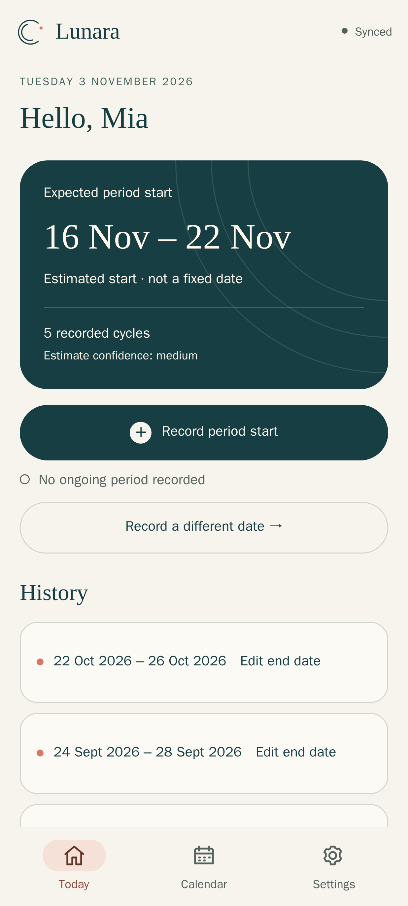
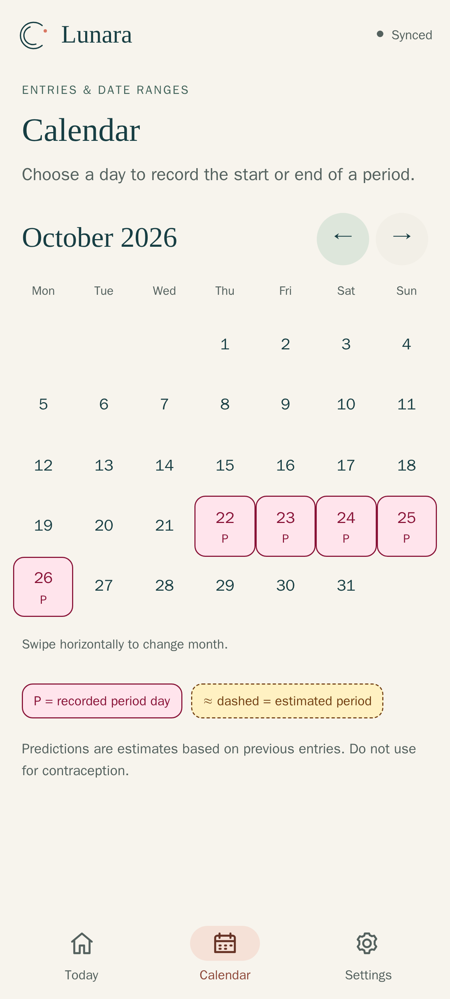
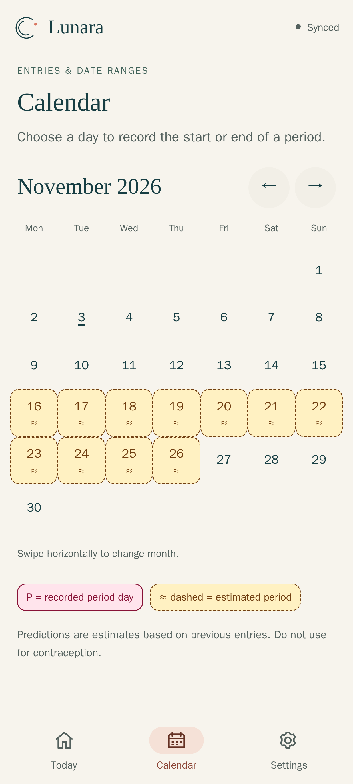
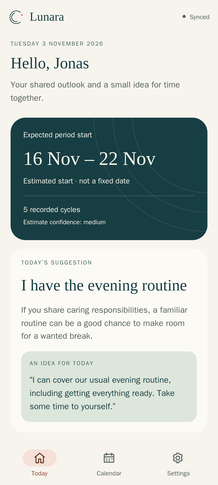
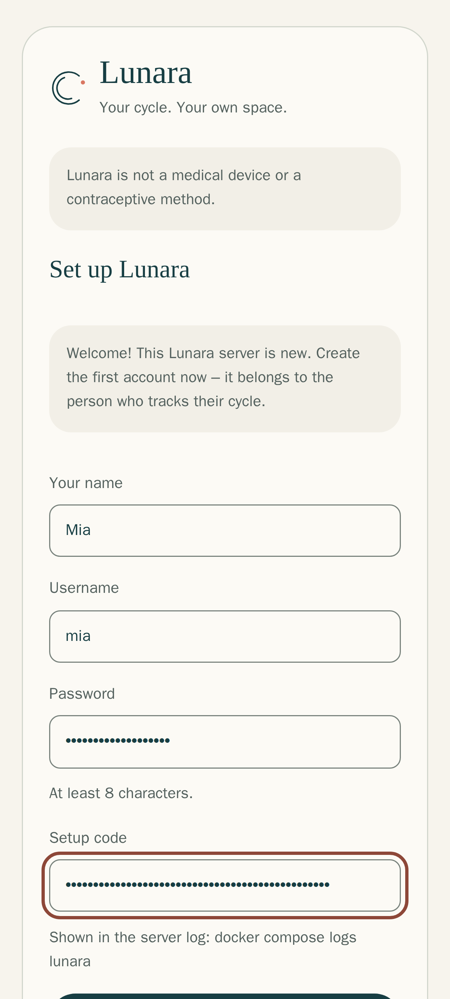
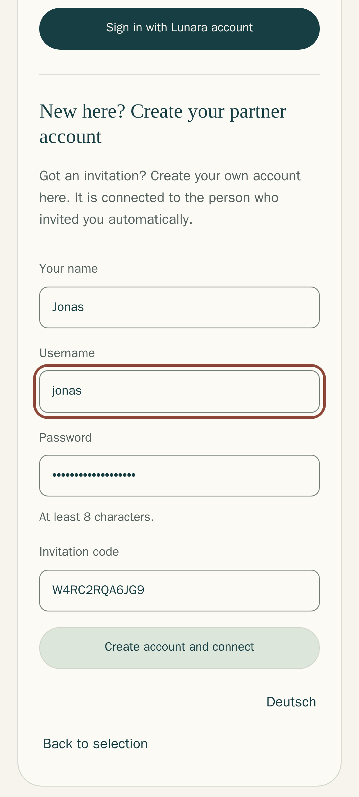

<div align="center">


# Lunara

**Your cycle. Your space. Shared only the way you want.**

A private **period & cycle tracker** for one person – and, if you like, their partner.<br>
Works **standalone on Android without any server**, or together via your own server.<br>
No ads, no tracking, no cloud company. Your data stays with you.

[](https://github.com/eliasbruno124-dev/Lunara/releases/latest)
[](LICENSE)






</div>

## What Lunara does for you

**For you**
- Record your period with one tap – the calendar shows past days (**P**) and the
  expected next period (**≈**).
- See *when* your next period will probably start, as an honest range.
- Decide yourself what your partner may see – at first only the expected date
  range is shared.

**For your partner**
- A calm view of what you chose to share: the expected time, and only if you
  want, more.
- A small, kind idea for everyday life – like taking over the evening routine.
- Their own account and app, connected to you with one invitation code.

> Lunara is not a medical device and must not be used for contraception.

## Works on its own – or with your own server

**The Android app is fully standalone.** Install the APK, choose
**Only on this device**, and you're done: no server, no account, no internet
connection needed. Your entries are stored encrypted on your phone only.

**Want to share with your partner or use several devices?** Then the same app
connects to your own Lunara server instead. You decide when you install it –
one app does both.

| | Standalone (just me) | With your own server (together) |
| --- | --- | --- |
| **What you need** | Only the Android app – no server | A small server you control (home server, Raspberry Pi, rented server) |
| **Effort** | 1 minute | about 10 minutes, once |
| **Your data** | Encrypted on your phone only | On your own server |
| **Start** | [Download the app](https://github.com/eliasbruno124-dev/Lunara/releases/latest) → *Only on this device* | Follow the 3 steps below |

## Install together in 3 steps

You need a computer with [Docker](https://docs.docker.com/engine/install/) and a
web address (domain) that points to it, e.g. `lunara.example.com`.

**1. Download the installation file into an empty folder**

```bash
mkdir lunara && cd lunara
curl -fsSLO https://raw.githubusercontent.com/eliasbruno124-dev/Lunara/main/examples/docker-compose.yml
```

**2. Tell Lunara your address and start it**

```bash
echo "LUNARA_DOMAIN=lunara.example.com" > .env
docker compose up -d
```

Lunara creates all passwords and keys by itself and gets a free HTTPS
certificate automatically. Nothing else to configure.

**3. Create your account in the browser**

```bash
docker compose logs lunara
```

This shows a one-time **setup code**. Open your address, choose **My own server**,
enter your name, a username, a password and the code – done.

<p>


</p>

**Then invite your partner:** *Settings → Using Lunara together → Invite partner*.
Your partner opens the same address, taps **I have an invitation** and creates
their own account with the code.

<details>
<summary><b>Using Portainer or an existing reverse proxy?</b></summary>

- **Portainer** (standalone Docker): *Stacks → Add stack*, paste
  [`docker-compose.yml`](examples/docker-compose.yml) and add the environment
  variable `LUNARA_DOMAIN`. The setup code is in the logs of the `lunara`
  container.
- **Already have Traefik, Nginx Proxy Manager, Caddy …?** Download
  [`docker-compose.proxy.yml`](examples/docker-compose.proxy.yml) and save it as
  `docker-compose.yml` – it leaves out the built-in HTTPS and explains how to
  connect your proxy. Everything else stays the same.

</details>

## Get the app on your phones

- **Android:** in Lunara open *Settings → App & connection → Download Android app*,
  or get `lunara-release.apk` from the [latest release](https://github.com/eliasbruno124-dev/Lunara/releases/latest).
- **iPhone:** open your Lunara address in Safari → *Share → Add to Home Screen*.
- **Computer:** just use the browser – or install it via the icon in the address bar.

Lunara starts in English; German is available too.

## Your privacy

- Your data lives on **your** phone or **your** server – never with us.
- No ads, no analytics, no tracking, no Google services.
- Passwords are stored as secure hashes, sensitive data is encrypted.
- Your partner only sees what you switch on (in the Android app), and you can
  switch it off anytime.

Details: [Privacy](PRIVACY.md) · [Security](SECURITY.md)

## Questions

<details><summary><b>Do I really need a domain?</b></summary>

For two phones that should sync from anywhere: yes, because the apps only talk
to Lunara over HTTPS. A free subdomain from a dynamic-DNS service works fine.
If you use Lunara alone on Android, you need nothing at all.
</details>

<details><summary><b>Does it run on a Raspberry Pi?</b></summary>

Yes. The image is built for normal PCs/servers (amd64) and for ARM (arm64), e.g.
Raspberry Pi 4 and 5.
</details>

<details><summary><b>How do I update?</b></summary>

```bash
docker compose pull && docker compose up -d
```

Android: install the new APK over the old one – don't uninstall first.
</details>

<details><summary><b>How do I back up?</b></summary>

Back up the two Docker volumes **`lunara_database`** and **`lunara_secrets`**
together – the keys in `secrets` are needed to read the data. A ready-made
command is in the [installation guide](docs/INSTALL.md#8-updates-backup-and-restore).
</details>

<details><summary><b>I forgot my password.</b></summary>

Lunara has no e-mail address of yours, so there is no reset link. Keep your
password in a password manager. While signed in, you can change it in the
Android app under *Settings → Account and security*.
</details>

<details><summary><b>Is the prediction reliable?</b></summary>

It is an estimate from your past cycles, shown as a range with a confidence
level – never as a fixed date. It is not suitable for contraception.
[How it works](ALGORITHM.md)
</details>

## More

- [Installation guide with screenshots](docs/INSTALL.md) – every step explained
- [Using the app: sharing, backups, new phone](docs/SETUP.md)
- [Sign in with Authentik (optional)](docs/AUTHENTIK.md)
- [Advanced setups: Traefik, Authentik/OIDC, scripts](DEPLOYMENT.md)
- [Changelog](CHANGELOG.md) · [Developing Lunara](docs/CODE_GUIDE.md) · [Testing](TESTING.md)

Found a bug? [Open an issue](https://github.com/eliasbruno124-dev/Lunara/issues).
Security problem? Please report it privately, see [SECURITY.md](SECURITY.md).

## License

This project is licensed under the MIT License. See [LICENSE](LICENSE) for details.

## Support the Developer

This app is free and open-source, maintained with a lot of love in my spare time. If it brings value to you and your partner, a small donation would mean the world to me.

<p align="center">
  <a href="https://paypal.me/eliasbruno123">
    
  </a>
</p>
