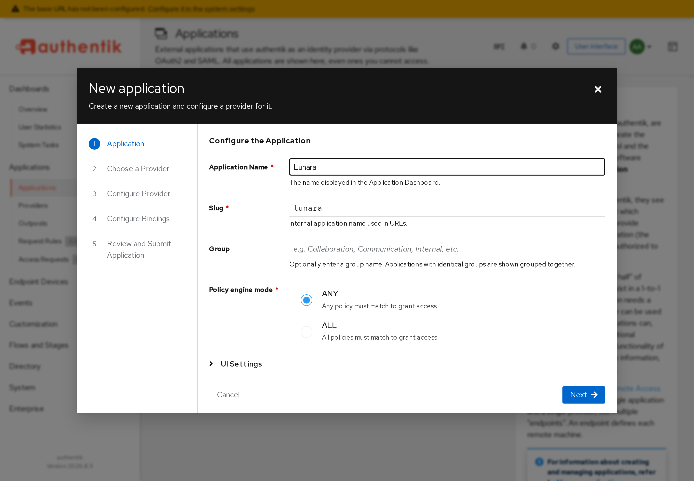
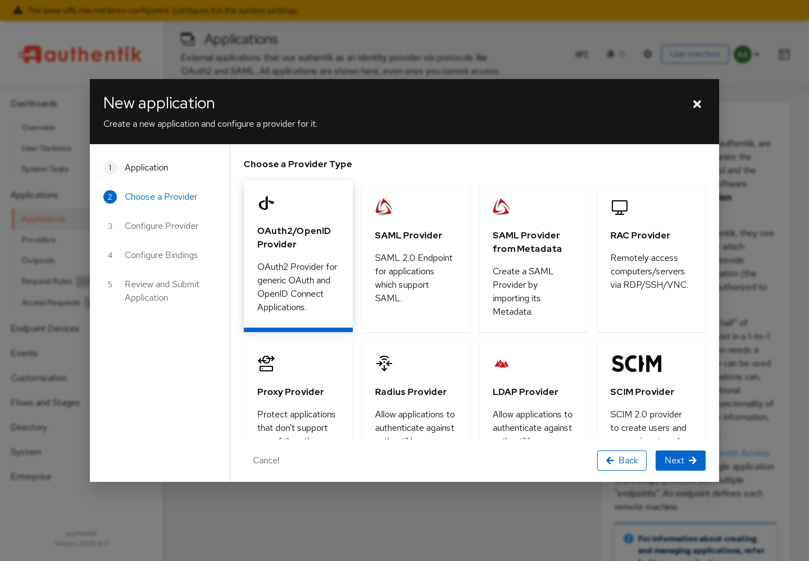
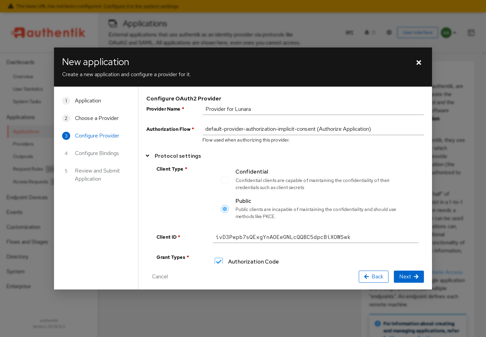
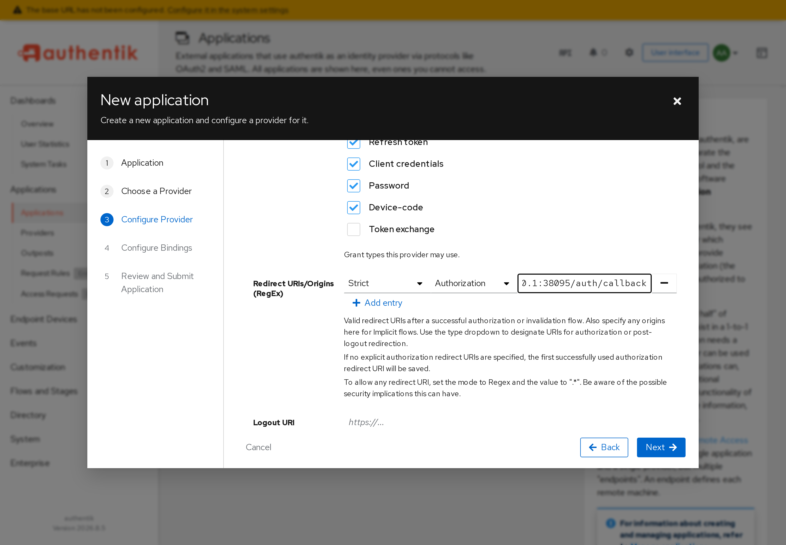
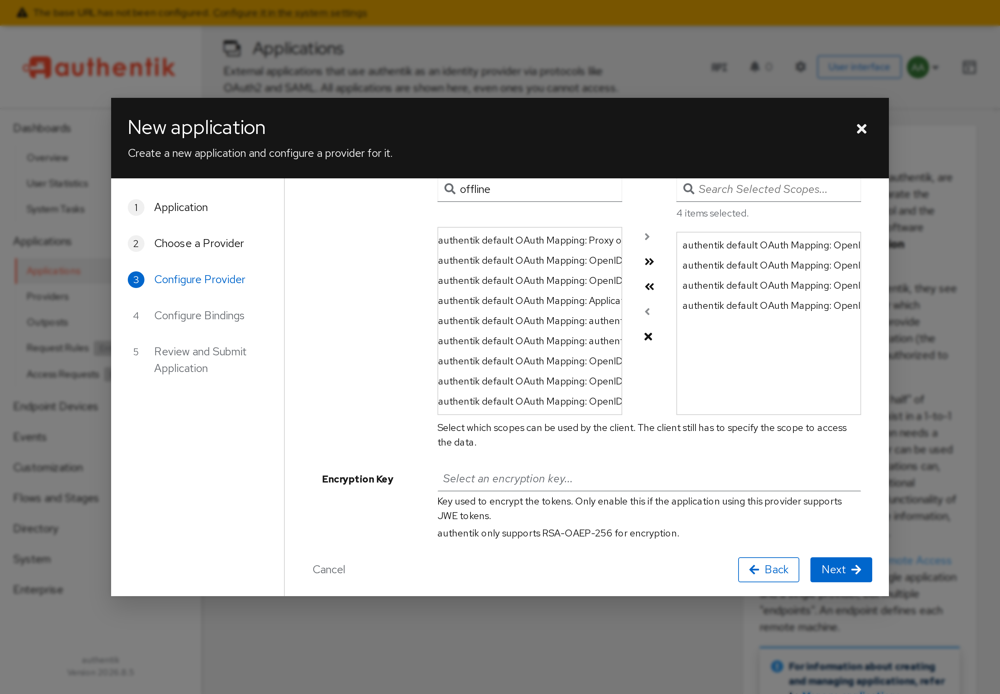
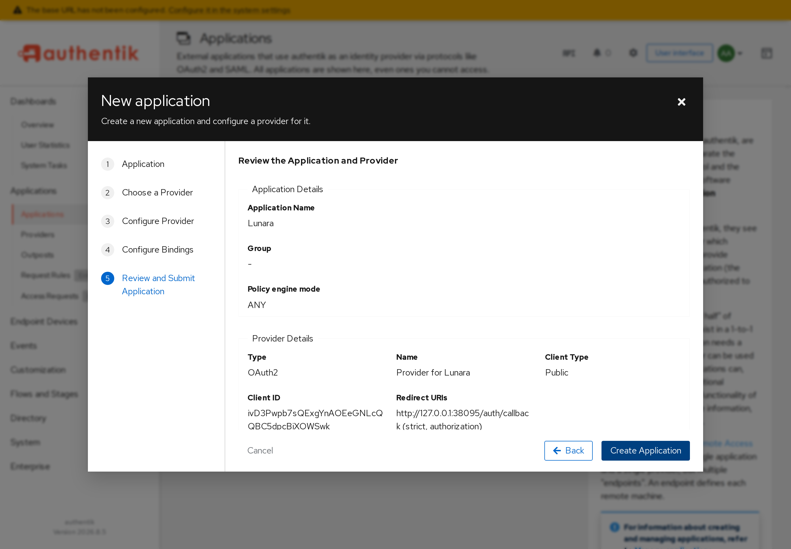
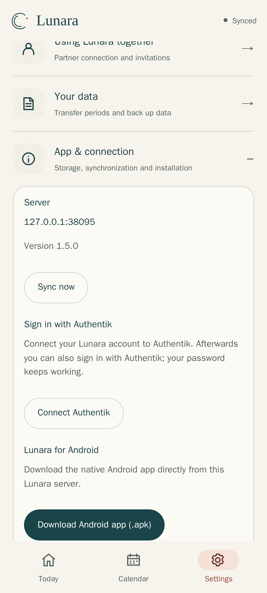
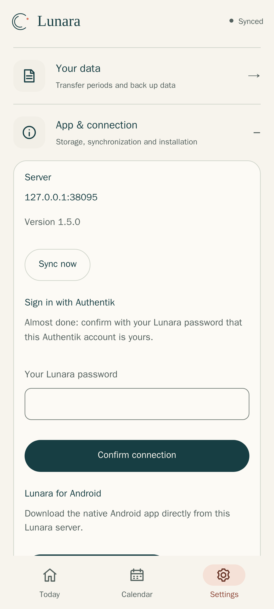

# Sign in with Authentik (optional)

Already use [Authentik](https://goauthentik.io) for your other apps? Then you
and your partner can sign in to Lunara with your Authentik account too – in the
browser, on iPhone and in the Android app. This is **optional** – Lunara works
perfectly with its own username and password.

It takes about 5 minutes: create one application in Authentik, add two lines to
Lunara's `.env`, then press one button in Lunara.

> Tested with Authentik 2026.8. The screenshots show a test instance.

## 1. Create the application in Authentik

Open the Authentik **Admin interface** → **Applications → Applications** and
click **New Application**. A wizard with five steps opens.

**Step 1 – Application:** *Application Name* `Lunara`. The *Slug* fills in
automatically and must be `lunara`. Click **Next**.



**Step 2 – Choose a Provider:** click **OAuth2/OpenID Provider**, then **Next**.



**Step 3 – Configure Provider:** only these fields matter:

| Field | What to choose |
| --- | --- |
| *Authorization Flow* | `default-provider-authorization-implicit-consent` |
| *Client Type* | **Public** |
| *Client ID* | leave as it is – **copy it**, you need it in section 2 |
| *Grant Types* | **Authorization Code** and **Refresh token** must be ticked (they are by default) |
| *Redirect URIs/Origins* | click **Add entry** twice, keep *Strict* for both:<br>1. `https://lunara.example.com/auth/callback` – your Lunara address + `/auth/callback` (browser, iPhone)<br>2. `https://lunara.3li361.de/auth/android-callback` – exactly like this, for the Android app (see below) |
| *Signing Key* | `authentik Self-signed Certificate` (already selected) |





Still in step 3, open **Advanced protocol settings**. Under *Scopes*, type
`offline` into *Search Available Scopes…*, click the entry
**authentik default OAuth Mapping: OpenID 'offline_access'** and move it to the
right with the **›** arrow. The right list now shows **4 items selected**.
This step is important: without it, signing in with Authentik fails.



**Step 4 – Configure Bindings:** nothing to do, click **Next**.

**Step 5 – Review and Submit:** check *Client Type: Public* and your redirect
URI, then click **Create Application**.



> Who may use Lunara is controlled in Authentik as usual: without bindings,
> every Authentik user can sign in, but only into a Lunara account they have
> connected themselves (see section 3). To restrict it, add a *Binding* to
> the application in Authentik.

## 2. Tell Lunara about Authentik

Add two lines to the `.env` file in your Lunara folder – your Authentik address
and the client ID you copied:

```ini
AUTHENTIK_URL=https://auth.example.com
AUTHENTIK_CLIENT_ID=paste-the-client-id-here
```

> Installed Lunara before version 1.5.0? Download the current
> `docker-compose.yml` once more into the same folder (your `.env` stays) –
> older files do not pass these two settings on:
> `curl -fsSLO https://raw.githubusercontent.com/eliasbruno124-dev/Lunara/main/examples/docker-compose.yml`
> (or `…/docker-compose.proxy.yml -o docker-compose.yml` if you use your own proxy).

Then restart Lunara:

```bash
docker compose up -d
```

**Portainer:** add the two variables to the stack's environment variables and
click *Update the stack*.

## 3. Connect your account

Each person does this once, while signed in to Lunara in the browser:

1. **Settings → App & connection → Connect Authentik**.
2. Sign in at Authentik as usual – you come straight back to Lunara.
3. Confirm with your **Lunara password** (this proves the Lunara account is
   yours) and tap **Confirm connection**.

<table>
<tr>
<td width="50%"></td>
<td width="50%"></td>
</tr>
</table>

From now on the sign-in page also shows **Sign in with Authentik**. Your
Lunara password keeps working as well.

### In the Android app

The Android app has the same functions built in:

- **Connect an existing account:** *Settings → Account and security →
  Connect Authentik*, confirm your Lunara password, sign in at Authentik in the
  browser – the app opens again by itself.
- **Sign in:** on the sign-in screen choose **Sign in with Authentik**.
- **Partner:** can redeem the invitation with Authentik in the app as well.

This needs the second redirect address from section 1
(`https://lunara.3li361.de/auth/android-callback`). It is the fixed return
address built into the official app: after signing in, Android hands the
result directly to the Lunara app on your phone. It does **not** go to your
server or to anyone else's – the address only serves as the app's verified
"doorbell" (Android checks it once against the app's signing certificate).

Your partner first creates their account with the invitation code (see
[INSTALL.md](INSTALL.md#4-invite-your-partner)) and then connects Authentik the
same way.

## Good to know

- **Want to avoid the shared Android return address?** Build the APK yourself
  with your own domain (`LUNARA_APP_LINK_HOST`), see
  [DEPLOYMENT.md](../DEPLOYMENT.md#android-the-api-domain-is-not-the-callback-host).
  The browser and iPhone never use it.
- **Different slug:** if your Authentik application's slug is not `lunara`,
  also add `AUTHENTIK_SLUG=your-slug` to `.env`.
- **Other OIDC providers** (Keycloak, Zitadel, Pocket ID …) work too; set the
  `OIDC_*` variables yourself as described in [DEPLOYMENT.md](../DEPLOYMENT.md).

## If something does not work

| Message or problem | Fix |
| --- | --- |
| No "Connect Authentik" in the settings | The two lines are missing in `.env`, or Lunara was not restarted (`docker compose up -d`) |
| Authentik shows "redirect URI … not allowed" / "malformed" | Browser: the redirect URI must be exactly `https://your-lunara-address/auth/callback`. Android app: `https://lunara.3li361.de/auth/android-callback` must be entered as well |
| Android: after signing in, the browser stays open instead of returning to the app | Update the app to the latest version and open the link again; Android verifies the app's return address once after installation (internet needed) |
| "Sign-in with Authentik could not be completed" | In Authentik, add the scope `offline_access` (section 1, step 3) and check that *Refresh token* is ticked under *Grant Types* |
| "That did not work. Check your password." | Use your Lunara password (not the Authentik one). An Authentik account can be connected to only one Lunara account |
