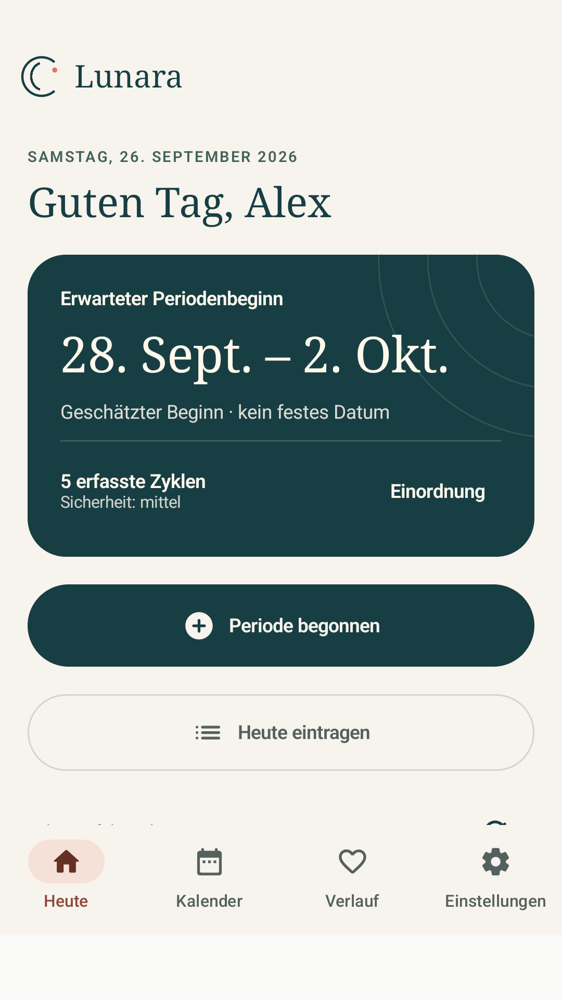
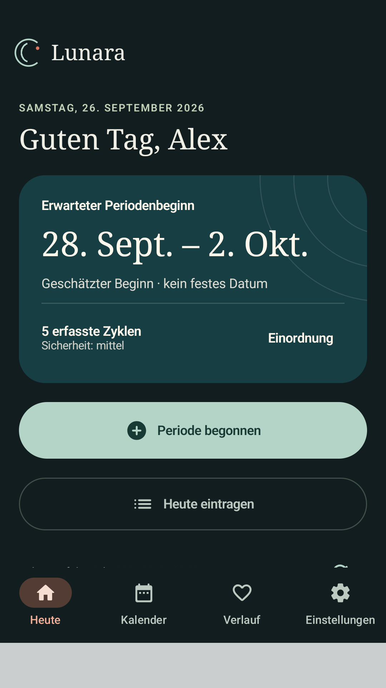
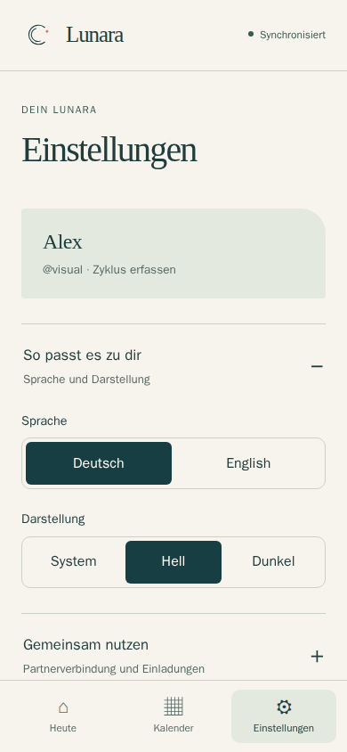

# Lunara Journal · Gestaltung ab 1.2

## Richtung

Eine ruhige, eigenständige Journal-Oberfläche statt einer Sammlung gleich
gewichteter Dashboard-Karten. Warmes Elfenbein, tiefes Petrol, Salbei und ein
zurückhaltender Korallakzent. Serifenschrift für Überschriften; klare
serifenlose Schrift für Daten, Eingaben und Aktionen. Ausschließlich lokale
Systemschriften, keine Font-CDNs oder heruntergeladenen Design-Assets.

Android-Tokens: `BrandTokens.kt` und `LunaraTheme.kt`. Web-Tokens stehen am
Anfang von `apps/web/src/styles.css`. Hell und Dunkel haben eigene vollständige
Farbrollen. Das Vektorzeichen besteht aus offenen Bögen und einem Akzentpunkt;
es stellt weder Ovulation noch einen gemessenen Zyklusfortschritt dar.

## Informationshierarchie

| Ansicht | Im Vordergrund | Dahinter / auf Anfrage |
|---|---|---|
| Heute · Tracker | Zeitraum, Periode beginnen/beenden, Tag erfassen | Erklärung der Unsicherheit, letzter Abgleich, letzte Einträge |
| Heute · Partner | Verbindung, konkrete Unterstützung, Check-in | ausschließlich geteilter Ausblick, Phase und Abgleich |
| Kalender | wischbare Monate und antippbare Zeiträume | Erfassungsanleitung, Legende und Sicherheitshinweise |
| Verlauf | erfasste Längen, übersichtliche Kennzahlen | einzeln bearbeitbare Aufzeichnungen |
| Einstellungen | benannte Kategorien | die tatsächlich zugehörigen Bedienelemente |

Die Vorhersage zeigt weiterhin einen geschätzten Beginn und keinen exakten
Termin. Ihre Unsicherheit wird nicht durch ein präzise aussehendes Diagramm
verdeckt. Erklärungen sind über „Einordnung“ zugänglich. Fertilitätshinweise
bleiben direkt bei der optionalen Schätzung sichtbar.

## Unterstützung

Ein Tipp ist keine Schlagzeile über den Zustand einer Person. Die Karte
trennt Kontext und eine konkrete Handlung. „Warum dieser Tipp?“ erklärt die
zulässige Auswahlgrundlage; persönliche Wünsche bleiben wichtiger als der
Katalog. Keine Generierung zur Laufzeit und keine angebliche fachliche oder
klinische Validierung. Redaktion und Grenzen: [TIP_QUALITY.md](TIP_QUALITY.md).

## Bedienung und Grenzen

- Unveränderte Konten, Signatur, Offline-Queue, Authentifizierung und Freigaben.
- Android-Einstellungen haben einen expliziten Zurückweg; System-Zurück
  führt aus einer Kategorie zur Übersicht.
- Flexible Text-/Buttonhöhen; Kalenderhöhe berücksichtigt größere Schrift.
- Kalenderstatus ist zusätzlich über Symbole und TalkBack beschrieben.
- PWA-Einstellungen nutzen native aufklappbare Bereiche. Monatsbuttons
  ergänzen Wischen und Tastaturbedienung.
- Keine externen Bild-, Schrift-, Tracking- oder Animationsdienste.

Visuelle Prüfungen benutzen ausschließlich synthetische Konten und Daten.
Ein Emulator-/Browser-Test ersetzt keine Prüfung auf jedem Herstellergerät
oder einen vollständigen unabhängigen Barrierefreiheitsaudit.

## Tatsächliche Ansichten

Aus Compose-Instrumentierung beziehungsweise Browserprüfung, ausschließlich
mit synthetischen Daten. Keine gerenderten Produkt-Mock-ups.

