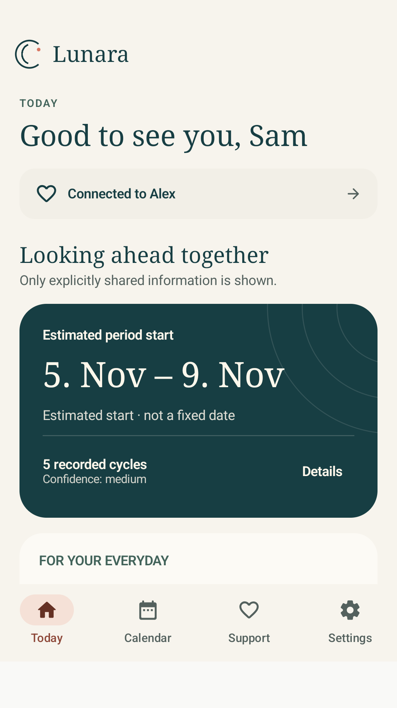
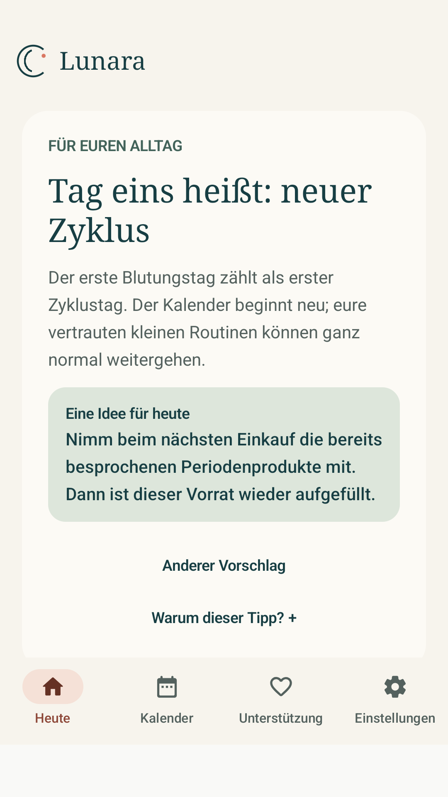

# Lunara Journal · Design from 1.2 onward

## Direction

A calm, distinctive journal interface rather than a collection of equally
weighted dashboard cards. Warm ivory, deep teal, sage, and a restrained
coral accent. Serif headings and clear sans-serif type for data, inputs,
and actions. Only local system fonts, with no font CDNs or downloaded
design assets.

Android tokens are in `BrandTokens.kt` and `LunaraTheme.kt`. Web tokens are
at the start of `apps/web/src/styles.css`. Light and dark themes each have
complete color roles. The vector mark consists of open arcs and an accent dot.
It represents neither ovulation nor measured progress through a cycle.

## Information hierarchy

| View | Primary content | Secondary / on request |
|---|---|---|
| Today · Tracker | Date range, start/end period, log today | Explanation of uncertainty, last sync, recent entries |
| Today · Partner | Connection, only the shared outlook and phase | Tip, check-in, and last sync below |
| Calendar | Swipeable months and tappable date ranges | Recording guidance, legend, and safety notices |
| History | Recorded lengths, clear summary statistics | Individually editable records |
| Settings | Named categories | The controls that belong to each category |

The prediction continues to show an estimated start rather than an exact
date. Its uncertainty is not hidden by a chart that appears precise.
Explanations are available under “Details.” Fertility notices remain
visible directly beside the optional estimate.

## Support

A tip is not a headline about a person's state. The card separates context
from a concrete action. “Why this tip?” explains the permitted basis for
selection. “An idea for today” remains an offer rather than an instruction.
Source links for background information open the browser only on request.
Personal wishes take priority over the catalog. There is no runtime
generation or claim of professional or clinical validation. Editorial
standards and limitations are in [TIP_QUALITY.md](TIP_QUALITY.md).

## Interaction and boundaries

- Accounts, signing, the offline queue, authentication, and sharing are unchanged.
- Android settings have an explicit way back. System Back returns from
  a category to the overview.
- Flexible text and button heights. Calendar height accommodates larger text.
- Calendar status is also described through symbols and TalkBack.
- PWA settings use native expandable sections. Month buttons complement
  swiping and keyboard interaction.
- No external image, font, tracking, or animation services.

Visual checks use synthetic accounts and data exclusively.
An emulator/browser test does not replace testing on every manufacturer's
device or a complete independent accessibility audit.

## Actual views

From Compose instrumentation or browser checks, using synthetic data
exclusively. These are not rendered product mockups.

Partner view from 1.2.1 onward shows the shared outlook first, followed by the tip.
The second image shows the screen scrolled farther down.

