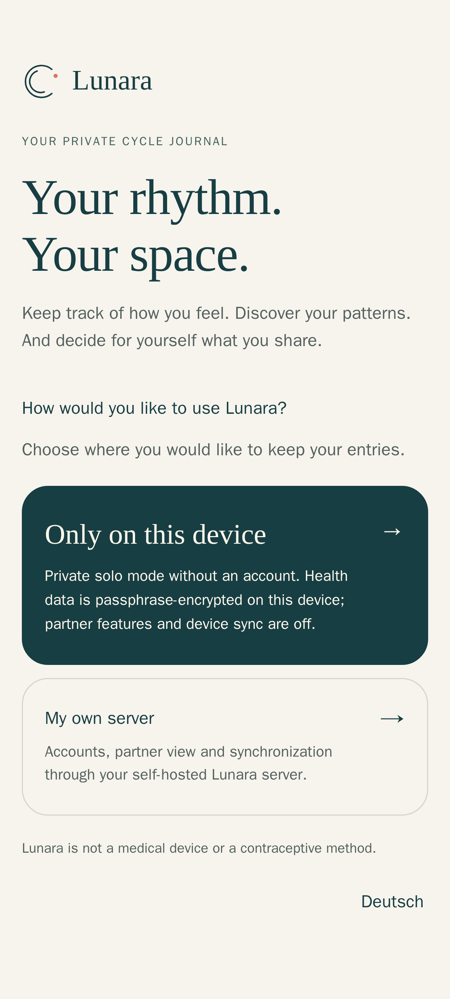
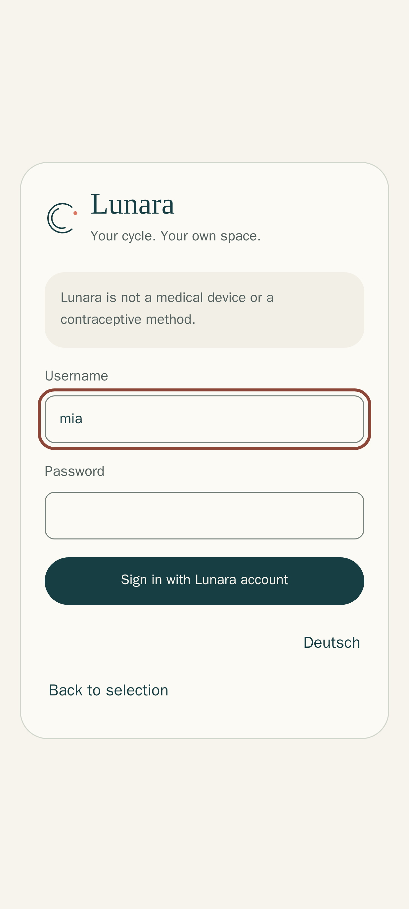
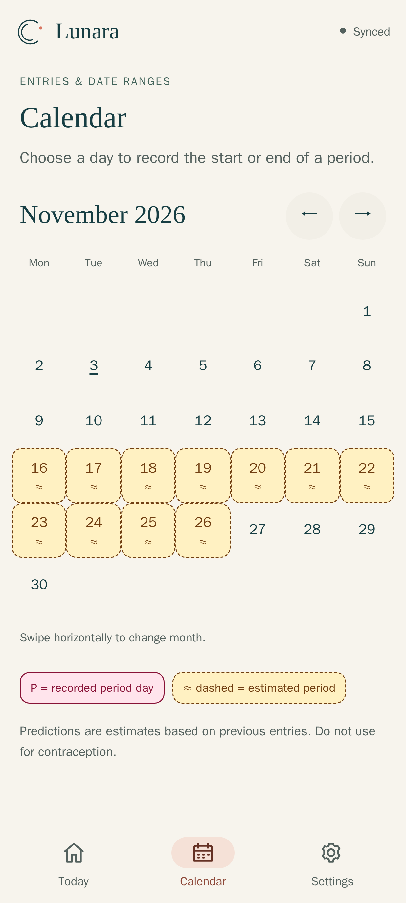
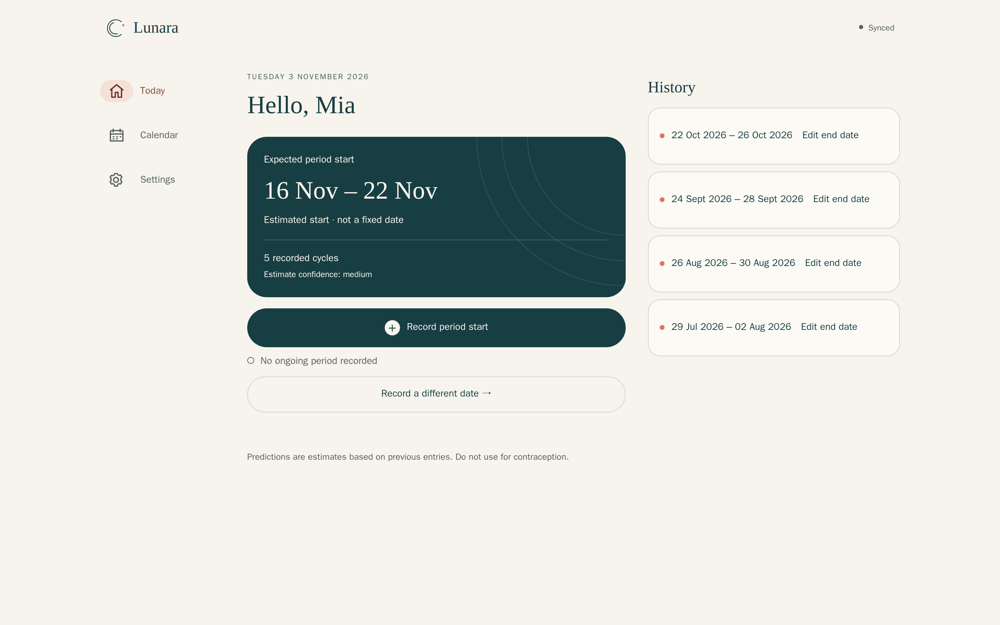
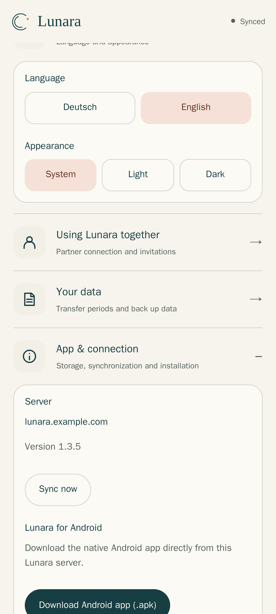
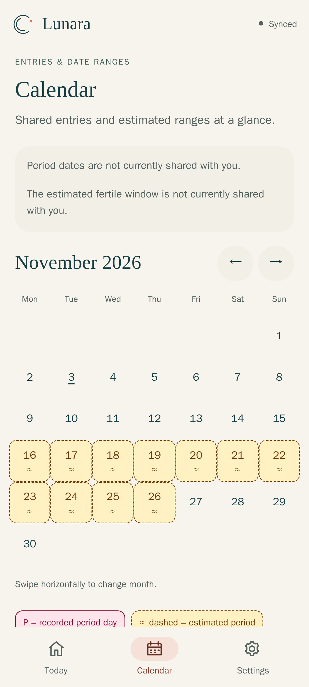

# Installing Lunara on your own server

This guide takes you from an empty Linux server to a running Lunara instance
with HTTPS, web app, Android app and partner access in about 15 minutes.
It applies to **Lunara 1.3.5**.

All screenshots show the real interface of a demo instance with made-up
accounts ("Mia" and "Jonas") and made-up data.

> Only want to use Lunara on your own Android phone? Then you do **not need a
> server**: download `lunara-release.apk` from the
> [releases](https://github.com/eliasbruno124-dev/Lunara/releases/latest),
> install it and choose **Only on this device**. Continue with
> [SETUP.md](SETUP.md).

---

## Contents

1. [How Lunara works](#1-how-lunara-works)
2. [Requirements](#2-requirements)
3. [Installation with Docker Compose](#3-installation-with-docker-compose)
4. [Setting up HTTPS](#4-setting-up-https)
5. [Creating the first account](#5-creating-the-first-account)
6. [Using the web app and the Android app](#6-using-the-web-app-and-the-android-app)
7. [Inviting a partner and choosing what to share](#7-inviting-a-partner-and-choosing-what-to-share)
8. [Updates, backup and restore](#8-updates-backup-and-restore)
9. [All settings](#9-all-settings)
10. [Troubleshooting](#10-troubleshooting)

---

## 1. How Lunara works

```text
  Phone (Android app)  ─┐
  Browser (web app/PWA) ┼──HTTPS──►  reverse proxy  ──►  lunara  ──►  postgres
  Partner's phone      ─┘            (Caddy/Traefik)     :3000        (internal)
```

- **One container for everything:** the image `ghcr.io/eliasbruno124-dev/lunara`
  contains the API, the installable web app and the signed Android APK. Sign-in,
  app and APK download all live under the same address.
- **PostgreSQL** stores accounts and entries. The database sits in an internal
  Docker network without internet access and without an open port.
- **`migrate`** is a short one-off container. On every start it brings the
  database schema up to the image's version and then exits. `lunara` only
  starts after it succeeded, so a new version never runs against an
  unfinished migration. Migrations that were already applied are not rolled
  back automatically – that is what the backup before an update is for.
- **Two roles per household:** the `TRACKER` records their cycle. The
  `PARTNER` only sees what the tracker explicitly shares, plus small everyday
  ideas.
- **Estimates** are calculated deterministically on the server from the
  previous cycles (method `lunara-robust-v2`, see [ALGORITHM.md](../ALGORITHM.md)).
  They are always shown as a range with a confidence level, never as a fixed
  date.
- **Security:** passwords are hashed with Argon2id. Access tokens are
  short-lived and refresh tokens rotate. Sensitive fields are encrypted with
  the `APP_MASTER_KEY`. There is no telemetry, no advertising and no Google
  services.

> Lunara is **not a medical device** and **not a contraceptive method**.
> Estimates are estimates.

## 2. Requirements

| What | Why |
| --- | --- |
| Linux server with Docker Engine 24+ and the Compose plugin | Lunara runs as containers (amd64 or arm64, e.g. Raspberry Pi 4/5) |
| about 300 MB RAM, 1 GB disk | Lunara and PostgreSQL together |
| a (sub)domain, e.g. `lunara.example.com` | the apps require **HTTPS**; without a `https://` address the server refuses to start |
| ports 80 and 443 reachable (only for the bundled Caddy) | for the automatic Let's Encrypt certificate |

## 3. Installation with Docker Compose

```bash
mkdir lunara && cd lunara
BASE=https://raw.githubusercontent.com/eliasbruno124-dev/Lunara/main/examples
curl -fsSLO $BASE/docker-compose.yml
curl -fsSLO $BASE/Caddyfile
curl -fsSL  $BASE/.env.example -o .env
chmod 600 .env
```

Now generate the secrets. Every value must be random and **unique**:

```bash
sed -i \
  -e "s|^POSTGRES_PASSWORD=.*|POSTGRES_PASSWORD=$(openssl rand -hex 32)|" \
  -e "s|^APP_MASTER_KEY=.*|APP_MASTER_KEY=$(openssl rand -base64 32)|" \
  -e "s|^AUTH_SIGNING_KEY=.*|AUTH_SIGNING_KEY=$(openssl rand -base64 48 | tr -d '\n')|" \
  -e "s|^REFRESH_TOKEN_PEPPER=.*|REFRESH_TOKEN_PEPPER=$(openssl rand -base64 48 | tr -d '\n')|" \
  -e "s|^BOOTSTRAP_TOKEN=.*|BOOTSTRAP_TOKEN=$(openssl rand -hex 24)|" \
  .env
```

Then open `.env` and enter your domain:

```ini
PUBLIC_BASE_URL=https://lunara.your-domain.com
LUNARA_DOMAIN=lunara.your-domain.com
```

What the values mean:

| Variable | Meaning |
| --- | --- |
| `POSTGRES_PASSWORD` | database password, only used internally |
| `APP_MASTER_KEY` | encrypts sensitive fields in the database. **If it is lost, that data can no longer be read.** Keep it safe together with your backups |
| `AUTH_SIGNING_KEY` | signs the short-lived access tokens. Changing it invalidates current access tokens; signed-in devices renew them automatically |
| `REFRESH_TOKEN_PEPPER` | additional protection for stored refresh tokens |
| `BOOTSTRAP_TOKEN` | one-time code for creating the very first account; remove it afterwards |

The complete, commented file is
[`examples/docker-compose.yml`](../examples/docker-compose.yml).

## 4. Setting up HTTPS

**Option A – bundled Caddy (easiest).** Your domain must point to the server
via DNS. Then:

```bash
docker compose --profile caddy up -d
docker compose ps
```

Caddy obtains the certificate automatically. After about 30 seconds
`https://lunara.your-domain.com/health` should return `{"status":"ok"}`.

**Option B – existing reverse proxy** (Traefik, nginx, Nginx Proxy Manager,
Pangolin …): start Lunara only:

```bash
docker compose up -d
```

Lunara then listens on `127.0.0.1:3000` (configurable via `LUNARA_PORT`).
Forward your domain there over HTTPS. An nginx example:

```nginx
location / {
    proxy_pass http://127.0.0.1:3000;
    proxy_set_header Host $host;
    proxy_set_header X-Forwarded-For $proxy_add_x_forwarded_for;
    proxy_set_header X-Forwarded-Proto https;
    proxy_buffering off;   # for live synchronization (server-sent events)
}
```

Lunara trusts exactly **one** proxy in front of it (`trust proxy 1`). Several
proxies in a row distort the client IP used by the sign-in rate limit.

## 5. Creating the first account

A fresh instance is empty. The first account becomes the **tracker** and needs
the `BOOTSTRAP_TOKEN` from `.env` once.

**With the Android app:** choose **Connect a server or partner**, enter the
address, tap **Test connection** and then **Set up Lunara for the first time**.
Paste the token there.

**Without Android, directly on the server** (requires `jq`, e.g.
`apt install jq`). Username and password are prompted for and appear neither
on screen nor in the shell history:

```bash
IFS= read -rp  'Username: ' LUNARA_USER
IFS= read -rsp 'Password (min. 8 characters): ' LUNARA_PASSWORD; echo
TOKEN=$(grep ^BOOTSTRAP_TOKEN= .env | cut -d= -f2-)
jq -n --arg u "$LUNARA_USER" --arg p "$LUNARA_PASSWORD" --arg t "$TOKEN" \
  '{username:$u, password:$p, displayName:$u, deviceName:"Setup",
    preferredLanguage:"EN", bootstrapToken:$t}' \
  | curl -fsS https://lunara.your-domain.com/api/v1/setup \
      -H 'Content-Type: application/json' --data-binary @- > /dev/null \
  && echo "Account created" \
  || echo "ERROR: account NOT created – do not remove the token yet"
unset LUNARA_PASSWORD TOKEN
```

**Only once the account exists** ("Account created", or signing in works in
the app), remove the token. It is never needed again:

```bash
sed -i 's/^BOOTSTRAP_TOKEN=.*/BOOTSTRAP_TOKEN=/' .env
docker compose up -d
```

Usernames have 3–64 characters (letters, digits, `.`, `_`, `-`).
Passwords need at least 8 characters.

## 6. Using the web app and the Android app

Open `https://lunara.your-domain.com` in your browser. Lunara starts in
English; **Deutsch** is available on the start screen and under
**Settings → Language**.

<table>
<tr>
<td width="33%"></td>
<td width="33%"></td>
<td width="33%"></td>
</tr>
<tr>
<td><b>1. Choose a mode.</b> "Only on this device" stores everything passphrase-encrypted in the browser, without any server. "My own server" synchronizes through your instance.</td>
<td><b>2. Sign in</b> with the account you just created. The web app is served by the server itself, so you don't have to enter an address.</td>
<td><b>3. Today.</b> At the top you see the expected start as a range, below it the number of recorded cycles and the estimate confidence. <i>Record period start</i> records today.</td>
</tr>
</table>

### The calendar

<table>
<tr>
<td width="50%"></td>
<td width="50%"></td>
</tr>
<tr>
<td><b>Recorded days</b> are pink and marked <b>P</b>. Tap a day to record or change the start or end of a period.</td>
<td><b>Estimated days</b> are yellow, have a dashed border and are marked <b>≈</b>. Swipe or use the arrows to look up to five years ahead.</td>
</tr>
</table>

If you only record the start, Lunara assumes an end after **five days**. You
can correct the end date at any time under *History*
(details: [PERIOD-ENDS.md](PERIOD-ENDS.md)).

### On the desktop



### Installing as an app



Under **Settings → App & connection** you will find:

- **Download Android app (.apk):** the native app is downloaded directly
  from your server (`/api/v1/downloads/lunara.apk`). It is the same signed APK
  as in the GitHub release. Install updates over the existing app; do not
  uninstall first.
- **iPhone:** in Safari, *Share → Add to Home Screen*. The web app then runs
  full-screen like an app.
- **Desktop (Chrome/Edge):** via the install icon in the address bar.

In the Android app, choose **Connect a server or partner** on first start, enter
`https://lunara.your-domain.com` and sign in. New installations of the app
start in English; German can be selected on the first screen (and on
Android 13+ also in the system's per-app language settings).

<br clear="right">

## 7. Inviting a partner and choosing what to share

1. The tracker opens **Settings → Using Lunara together → Invite partner**.
   Lunara creates a single-use code or link.
2. The partner joins:
   - **Android app:** **Connect a server or partner** → enter the server
     address → **I have an invitation**, enter or scan the code and create
     their own account.
   - **Web app:** the partner needs an existing account on the server (for
     example created via the Android app, OIDC or open registration). After
     signing in, they enter the code under **Settings → Using Lunara together**
     or open the invitation link, and confirm the connection.
3. The tracker decides **what** is shared – estimate, period dates, fertile
   window and further details, each one individually. A new connection only
   shares the minimum at first.

<table>
<tr>
<td width="50%"></td>
<td width="50%"></td>
</tr>
<tr>
<td><b>Partner view.</b> Jonas sees the shared outlook and <i>today's suggestion</i>, a small idea for everyday life from more than 70 tips.</td>
<td>The <b>partner calendar</b> only shows what is shared. "Not shared" means neither "no entries" nor "deleted".</td>
</tr>
</table>

More: [SETUP.md](SETUP.md) (sharing, backups, changing devices) and
[PRIVACY.md](../PRIVACY.md).

## 8. Updates, backup and restore

**Update:** set the new `LUNARA_VERSION` in `.env` (see
[releases](https://github.com/eliasbruno124-dev/Lunara/releases)) and run:

```bash
docker compose pull
docker compose up -d        # or with --profile caddy
```

`migrate` updates the schema automatically. Read the release notes first.
Downgrading to an older version is not supported, so always **take a backup
first**.

**Backup** (database while running, files readable only by you):

```bash
umask 077
docker compose exec -T postgres pg_dump -U lunara -Fc lunara > lunara-$(date +%F).dump
cp .env lunara-env-$(date +%F).bak   # contains APP_MASTER_KEY, keep it safe!
```

**Restore** with the **same** `.env`. Lunara is only started again once the
restore has completed without errors:

```bash
docker compose stop lunara
docker compose up -d --wait postgres
docker compose exec -T postgres pg_restore -U lunara -d lunara \
    --clean --if-exists --single-transaction --exit-on-error < lunara-2026-11-03.dump \
  && docker compose up -d
```

Without the matching `APP_MASTER_KEY` a backup is only partially readable.

## 9. All settings

The example contains the most important variables. You can add any of the
following to the `environment:` section of the `lunara` service:

| Variable | Default | Purpose |
| --- | --- | --- |
| `REGISTRATION_ENABLED` | `false` | `true` lets other people create their own tracker accounts. Partners always join via invitations |
| `ACCESS_TOKEN_TTL_SECONDS` | `900` | lifetime of an access token |
| `REFRESH_TOKEN_TTL_DAYS` | `30` | how long an unused device stays signed in |
| `INVITATION_TTL_MINUTES` | `30` | validity of time-limited invitations |
| `LOG_LEVEL` | `info` | `debug`, `info`, `warn`, `error` |
| `TZ` | `Europe/Berlin` | server time zone |
| `OIDC_ENABLED` … | `false` | optional sign-in via Authentik/OIDC, see [DEPLOYMENT.md](../DEPLOYMENT.md) |
| `OPENAPI_ENABLED` | `false` | API documentation under `/api-docs`, only with password protection |

**OIDC and the official APK:** the published Android app uses a built-in,
verified app-link callback for OIDC sign-in. Username and password work with
every instance. For OIDC sign-in in the Android app on your own domain, build
the APK yourself with `LUNARA_APP_LINK_HOST=your-domain`, see
[DEPLOYMENT.md](../DEPLOYMENT.md#android-the-api-domain-is-not-the-callback-host).
OIDC in the browser works without your own build.

## 10. Troubleshooting

| Symptom | Cause and fix |
| --- | --- |
| `lunara` does not start, log: `PUBLIC_BASE_URL must use HTTPS` | `PUBLIC_BASE_URL` must start with `https://` |
| log: `APP_MASTER_KEY must be exactly 32 random bytes` | regenerate with `openssl rand -base64 32` (not `-hex`) |
| `migrate` exits with an error | `docker compose logs migrate`. Usually the database is unreachable or the password was changed after the first installation |
| app: connection failed | open `https://…/health` in the phone's browser; check certificate and DNS |
| sign-in: "Too Many Requests" | sign-in rate limit (3 attempts per minute). Wait a minute |
| an Android update cannot be installed | the APK must be signed with the same key. Self-built APKs do not replace the official one |

View logs: `docker compose logs -f lunara`.
Report bugs: [GitHub issues](https://github.com/eliasbruno124-dev/Lunara/issues).
Report security issues privately, see [SECURITY.md](../SECURITY.md).
