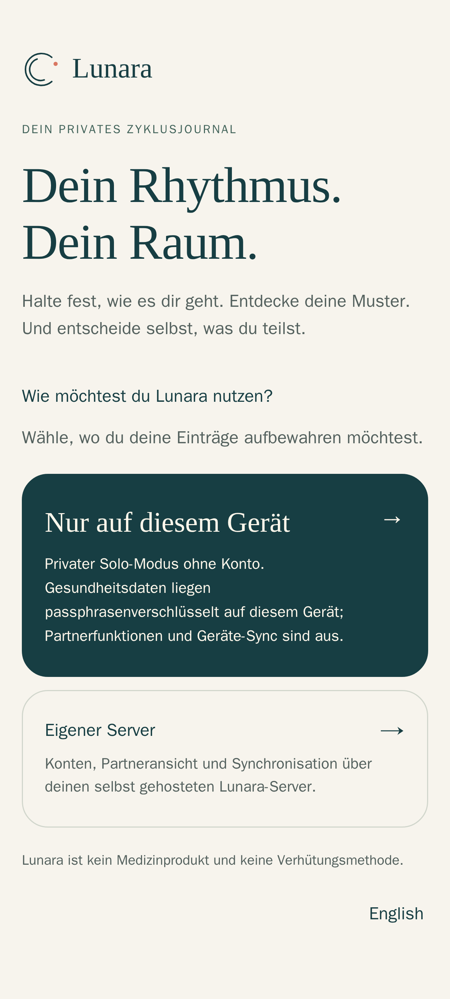
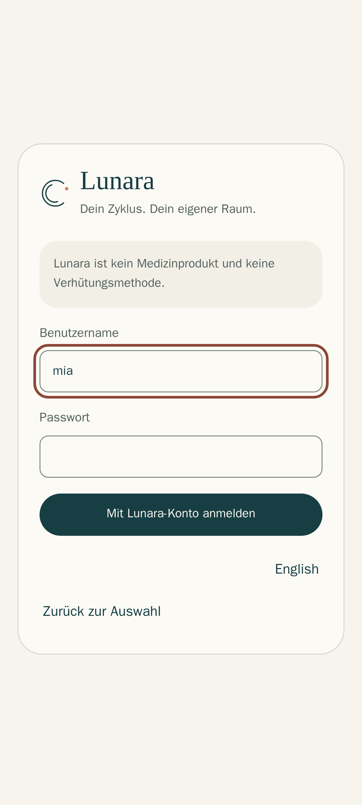
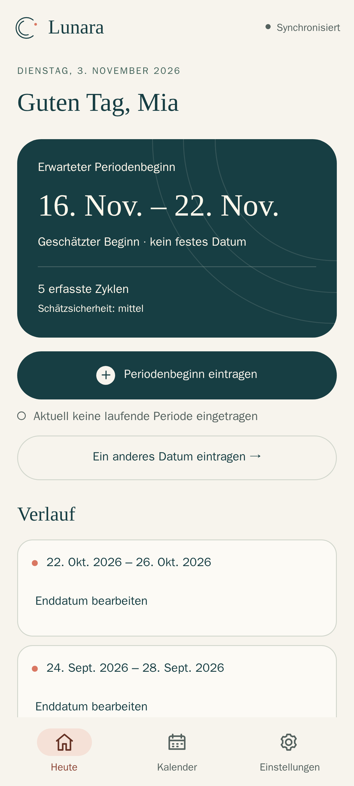
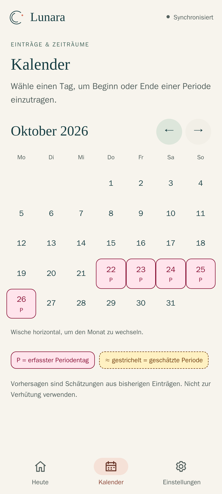
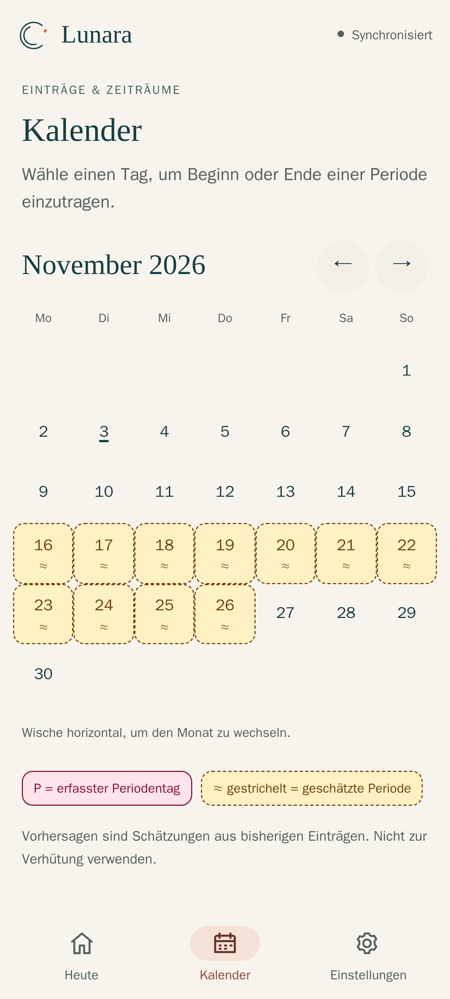
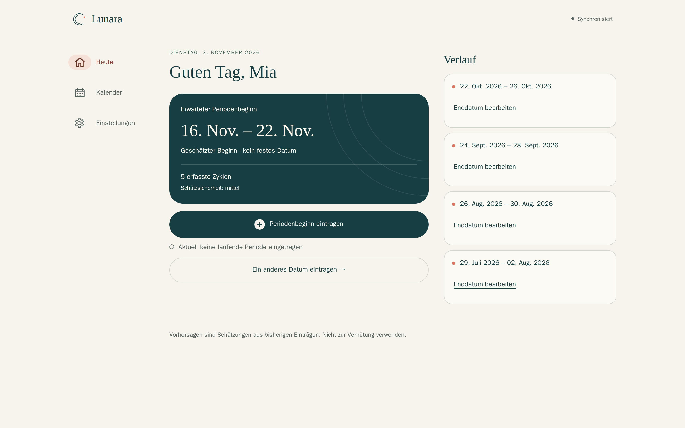
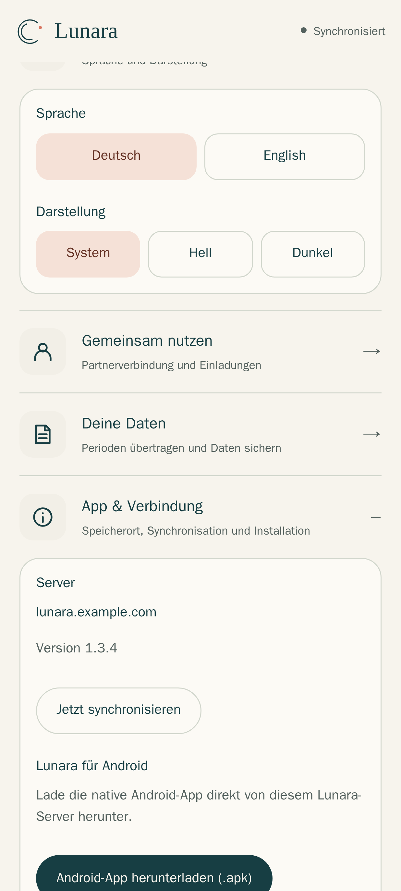
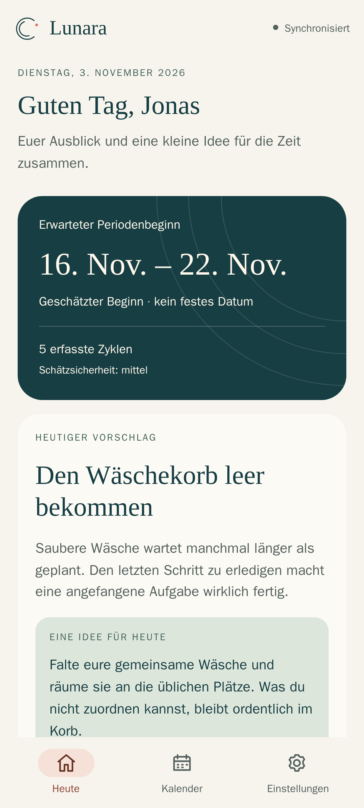
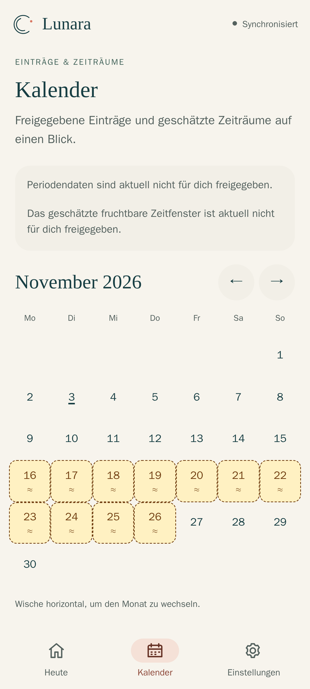

# Lunara auf dem eigenen Server installieren

Diese Anleitung führt in etwa 15 Minuten von einem leeren Linux-Server zu einer
laufenden Lunara-Instanz mit HTTPS, Web-App, Android-App und Partnerzugang.
Sie gilt für **Lunara 1.3.4**.

Alle Bilder stammen aus der echten Oberfläche einer Demo-Instanz mit
erfundenen Konten („Mia“ und „Jonas“) und erfundenen Daten.

> Du willst Lunara nur allein auf deinem Android-Handy nutzen? Dann brauchst
> du **keinen Server**: Lade `lunara-release.apk` aus den
> [Releases](https://github.com/eliasbruno124-dev/Lunara/releases/latest),
> installiere sie und wähle **Nur auf diesem Gerät**. Weiter mit
> [SETUP.md](SETUP.md).

---

## Inhalt

1. [So funktioniert Lunara](#1-so-funktioniert-lunara)
2. [Voraussetzungen](#2-voraussetzungen)
3. [Installation mit Docker Compose](#3-installation-mit-docker-compose)
4. [HTTPS einrichten](#4-https-einrichten)
5. [Erstes Konto anlegen](#5-erstes-konto-anlegen)
6. [Web-App und Android-App verwenden](#6-web-app-und-android-app-verwenden)
7. [Partner einladen und Freigaben wählen](#7-partner-einladen-und-freigaben-wählen)
8. [Updates, Backup und Wiederherstellung](#8-updates-backup-und-wiederherstellung)
9. [Alle Einstellungen](#9-alle-einstellungen)
10. [Fehlersuche](#10-fehlersuche)

---

## 1. So funktioniert Lunara

```text
  Handy (Android-App)  ─┐
  Browser (Web-App/PWA) ┼──HTTPS──►  Reverse-Proxy  ──►  lunara  ──►  postgres
  Partner-Handy        ─┘            (Caddy/Traefik)     :3000        (intern)
```

- **Ein Container für alles:** Das Image `ghcr.io/eliasbruno124-dev/lunara`
  enthält die API, die installierbare Web-App und die signierte Android-APK.
  Unter derselben Adresse findest du also Login, App und APK-Download.
- **PostgreSQL** speichert Konten und Einträge. Die Datenbank liegt in einem
  internen Docker-Netz ohne Internetzugang und ohne offenen Port.
- **`migrate`** ist ein kurzer Einmal-Container. Er bringt bei jedem Start das
  Datenbankschema auf den Stand der Image-Version und beendet sich dann.
  Ohne ihn startet `lunara` nicht. So kann ein Update kein halb
  migriertes Schema hinterlassen.
- **Zwei Rollen pro Haushalt:** Die `TRACKER`-Person erfasst ihren Zyklus.
  Die `PARTNER`-Person sieht nur, was die Tracker-Person ausdrücklich
  freigibt, und bekommt dazu kleine Ideen für den Alltag.
- **Vorhersagen** berechnet der Server deterministisch aus den bisherigen
  Zyklen (Verfahren `lunara-robust-v2`, siehe [ALGORITHM.md](../ALGORITHM.md)).
  Sie werden immer als Zeitraum mit einer Schätzsicherheit angezeigt, nie als
  festes Datum.
- **Sicherheit:** Passwörter werden mit Argon2id gehasht. Die Access-Tokens
  laufen kurz, die Refresh-Tokens rotieren. Sensible Felder werden mit dem
  `APP_MASTER_KEY` verschlüsselt. Es gibt keine Telemetrie, keine Werbung und
  keine Google-Dienste.

> Lunara ist **kein Medizinprodukt** und **keine Verhütungsmethode**.
> Vorhersagen sind Schätzungen.

## 2. Voraussetzungen

| Was | Warum |
| --- | --- |
| Linux-Server mit Docker Engine 24+ und Compose-Plugin | Lunara läuft als Container (amd64 oder arm64, z. B. Raspberry Pi 4/5) |
| ca. 300 MB RAM, 1 GB Speicher | Lunara und PostgreSQL zusammen |
| eine (Sub-)Domain, z. B. `lunara.example.com` | Die Apps verlangen **HTTPS**. Ohne gültiges Zertifikat lehnt der Server den Start ab |
| Ports 80 und 443 erreichbar (nur beim mitgelieferten Caddy) | für das automatische Let's-Encrypt-Zertifikat |

## 3. Installation mit Docker Compose

```bash
mkdir lunara && cd lunara
BASE=https://raw.githubusercontent.com/eliasbruno124-dev/Lunara/main/examples
curl -fsSLO $BASE/docker-compose.yml
curl -fsSLO $BASE/Caddyfile
curl -fsSL  $BASE/.env.example -o .env
chmod 600 .env
```

Erzeuge jetzt die Geheimnisse. Jeder Wert muss **einzeln** und zufällig sein:

```bash
sed -i \
  -e "s|^POSTGRES_PASSWORD=.*|POSTGRES_PASSWORD=$(openssl rand -hex 32)|" \
  -e "s|^APP_MASTER_KEY=.*|APP_MASTER_KEY=$(openssl rand -base64 32)|" \
  -e "s|^AUTH_SIGNING_KEY=.*|AUTH_SIGNING_KEY=$(openssl rand -base64 48 | tr -d '\n')|" \
  -e "s|^REFRESH_TOKEN_PEPPER=.*|REFRESH_TOKEN_PEPPER=$(openssl rand -base64 48 | tr -d '\n')|" \
  -e "s|^BOOTSTRAP_TOKEN=.*|BOOTSTRAP_TOKEN=$(openssl rand -hex 24)|" \
  .env
```

Öffne danach `.env` und trage deine Domain ein:

```ini
PUBLIC_BASE_URL=https://lunara.deine-domain.de
LUNARA_DOMAIN=lunara.deine-domain.de
```

Was die Werte bedeuten:

| Variable | Bedeutung |
| --- | --- |
| `POSTGRES_PASSWORD` | Datenbankpasswort, wird nur intern verwendet |
| `APP_MASTER_KEY` | verschlüsselt sensible Felder in der Datenbank. **Geht er verloren, sind diese Daten nicht mehr lesbar.** Zusammen mit dem Backup sicher aufbewahren |
| `AUTH_SIGNING_KEY` | signiert die Anmelde-Tokens. Wird er geändert, müssen sich alle neu anmelden |
| `REFRESH_TOKEN_PEPPER` | zusätzlicher Schutz der gespeicherten Refresh-Tokens |
| `BOOTSTRAP_TOKEN` | Einmal-Code zum Anlegen des allerersten Kontos, danach löschen |

Die vollständige, kommentierte Datei liegt unter
[`examples/docker-compose.yml`](../examples/docker-compose.yml).

## 4. HTTPS einrichten

**Variante A – mitgelieferter Caddy (am einfachsten).** Die Domain muss per
DNS auf den Server zeigen. Dann:

```bash
docker compose --profile caddy up -d
docker compose ps
```

Caddy holt das Zertifikat automatisch. Nach etwa 30 Sekunden sollte
`https://lunara.deine-domain.de/health` die Antwort `{"status":"ok"}` liefern.

**Variante B – vorhandener Reverse-Proxy** (Traefik, nginx, Nginx Proxy
Manager, Pangolin …): Starte nur Lunara:

```bash
docker compose up -d
```

Lunara lauscht dann auf `127.0.0.1:3000` (über `LUNARA_PORT` änderbar).
Leite deine Domain per HTTPS dorthin weiter. Ein nginx-Beispiel:

```nginx
location / {
    proxy_pass http://127.0.0.1:3000;
    proxy_set_header Host $host;
    proxy_set_header X-Forwarded-For $proxy_add_x_forwarded_for;
    proxy_set_header X-Forwarded-Proto https;
    proxy_buffering off;   # für die Live-Synchronisation (Server-Sent Events)
}
```

Lunara vertraut genau **einem** Proxy vor sich (`trust proxy 1`). Mehrere
hintereinander geschaltete Proxys verfälschen die Client-IP für die
Login-Bremse.

## 5. Erstes Konto anlegen

Eine frische Instanz ist leer. Das erste Konto wird die **Tracker-Person**
und braucht einmalig den `BOOTSTRAP_TOKEN` aus der `.env`.

**Mit der Android-App:** Wähle **Eigener Server**, gib die Adresse ein und
dann **Verbindung testen** → **Lunara erstmals einrichten**. Füge dort den
Token ein.

**Ohne Android, direkt am Server** (braucht `jq`, z. B. `apt install jq`).
Benutzername und Passwort werden abgefragt und erscheinen weder auf dem
Bildschirm noch in der Shell-History:

```bash
IFS= read -rp  'Benutzername: ' LUNARA_USER
IFS= read -rsp 'Passwort (mind. 8 Zeichen): ' LUNARA_PASSWORD; echo
TOKEN=$(grep ^BOOTSTRAP_TOKEN= .env | cut -d= -f2-)
jq -n --arg u "$LUNARA_USER" --arg p "$LUNARA_PASSWORD" --arg t "$TOKEN" \
  '{username:$u, password:$p, displayName:$u, deviceName:"Einrichtung",
    preferredLanguage:"DE", bootstrapToken:$t}' \
  | curl -fsS https://lunara.deine-domain.de/api/v1/setup \
      -H 'Content-Type: application/json' --data-binary @- > /dev/null \
  && echo "Konto angelegt" \
  || echo "FEHLER: Konto wurde NICHT angelegt – Token noch nicht entfernen"
unset LUNARA_PASSWORD TOKEN
```

**Erst wenn das Konto angelegt ist** (Meldung „Konto angelegt“ bzw. Anmeldung
in der App klappt), den Token entfernen. Er wird nie wieder gebraucht:

```bash
sed -i 's/^BOOTSTRAP_TOKEN=.*/BOOTSTRAP_TOKEN=/' .env
docker compose up -d
```

Benutzernamen haben 3–64 Zeichen (Buchstaben, Ziffern, `.`, `_`, `-`).
Passwörter brauchen mindestens 8 Zeichen.

## 6. Web-App und Android-App verwenden

Öffne `https://lunara.deine-domain.de` im Browser.

<table>
<tr>
<td width="33%"></td>
<td width="33%"></td>
<td width="33%"></td>
</tr>
<tr>
<td><b>1. Modus wählen.</b> „Nur auf diesem Gerät“ speichert passphrasenverschlüsselt im Browser, ganz ohne Server. „Eigener Server“ synchronisiert über deine Instanz.</td>
<td><b>2. Anmelden</b> mit dem eben angelegten Konto. Die Web-App kommt vom Server selbst, eine Adresse musst du deshalb nicht eingeben.</td>
<td><b>3. Heute.</b> Oben steht der erwartete Beginn als Zeitraum, darunter die Zahl der erfassten Zyklen und die Schätzsicherheit. Mit <i>Periodenbeginn eintragen</i> erfasst du den heutigen Tag.</td>
</tr>
</table>

### Der Kalender

<table>
<tr>
<td width="50%"></td>
<td width="50%"></td>
</tr>
<tr>
<td><b>Erfasste Tage</b> sind rosa und mit <b>P</b> markiert. Tippe einen Tag an, um Beginn oder Ende einer Periode einzutragen oder zu ändern.</td>
<td><b>Geschätzte Tage</b> sind gelb, gestrichelt umrandet und mit <b>≈</b> markiert. Mit Wischen oder den Pfeilen blätterst du bis zu fünf Jahre voraus.</td>
</tr>
</table>

Trägst du nur den Beginn ein, nimmt Lunara nach **fünf Tagen** automatisch
ein Ende an. Das Enddatum kannst du jederzeit unter *Verlauf* korrigieren
(Details: [PERIOD-ENDS.md](PERIOD-ENDS.md)).

### Auf dem Desktop



### Als App installieren



Unter **Einstellungen → App & Verbindung** findest du:

- **Android-App herunterladen (.apk):** Die native App wird direkt von deinem
  Server geladen (`/api/v1/downloads/lunara.apk`). Sie ist dieselbe signierte
  APK wie im GitHub-Release. Updates installierst du einfach über die
  vorhandene App, ohne vorher zu deinstallieren.
- **iPhone:** In Safari *Teilen → Zum Home-Bildschirm*. Die Web-App läuft
  dann wie eine App im Vollbild.
- **Desktop (Chrome/Edge):** über das Installieren-Symbol in der Adresszeile.

In der Android-App wählst du beim Start **Eigener Server**, gibst
`https://lunara.deine-domain.de` ein und meldest dich an.

<br clear="right">

## 7. Partner einladen und Freigaben wählen

1. Die Tracker-Person öffnet **Einstellungen → Gemeinsam nutzen → Partner
   einladen**. Lunara erzeugt einen einmalig nutzbaren Code bzw. Link.
2. Die Partner-Person wählt in der App **Eigener Server → Ich habe eine
   Einladung**, gibt den Code ein und legt ihr eigenes Konto an.
3. Die Tracker-Person legt fest, **was** geteilt wird: Vorhersage,
   Periodendaten, fruchtbares Zeitfenster und weitere Angaben, jede einzeln.
   Eine neue Verbindung teilt zunächst nur das Nötigste.

<table>
<tr>
<td width="50%"></td>
<td width="50%"></td>
</tr>
<tr>
<td><b>Partneransicht.</b> Jonas sieht den geteilten Ausblick und einen <i>heutigen Vorschlag</i>, eine kleine Idee für den Alltag aus über 70 Tipps.</td>
<td>Im <b>Partner-Kalender</b> erscheint nur, was freigegeben ist. „Nicht freigegeben“ heißt weder „keine Einträge“ noch „gelöscht“.</td>
</tr>
</table>

Mehr dazu: [SETUP.md](SETUP.md) (Freigaben, Backups, Gerätewechsel) und
[PRIVACY.md](../PRIVACY.md).

## 8. Updates, Backup und Wiederherstellung

**Update:** Setze in `.env` die neue `LUNARA_VERSION` (siehe
[Releases](https://github.com/eliasbruno124-dev/Lunara/releases)) und führe
dann aus:

```bash
docker compose pull
docker compose up -d        # bzw. mit --profile caddy
```

`migrate` aktualisiert das Schema automatisch. Lies vorher die Release-Notes.
Ein Downgrade auf eine ältere Version wird nicht unterstützt, deshalb immer
**vorher ein Backup** anlegen.

**Backup** (Datenbank im laufenden Betrieb, Dateien nur für dich lesbar):

```bash
umask 077
docker compose exec -T postgres pg_dump -U lunara -Fc lunara > lunara-$(date +%F).dump
cp .env lunara-env-$(date +%F).bak   # enthält APP_MASTER_KEY, sicher aufbewahren!
```

**Wiederherstellen** mit **derselben** `.env`. Lunara wird erst wieder
gestartet, wenn die Wiederherstellung fehlerfrei durchgelaufen ist:

```bash
docker compose stop lunara
docker compose up -d --wait postgres
docker compose exec -T postgres pg_restore -U lunara -d lunara \
    --clean --if-exists --single-transaction --exit-on-error < lunara-2026-11-03.dump \
  && docker compose up -d
```

Ohne den passenden `APP_MASTER_KEY` ist ein Backup nur teilweise lesbar.

## 9. Alle Einstellungen

Das Beispiel enthält die wichtigsten Variablen. Alle weiteren kannst du im
Abschnitt `environment:` des `lunara`-Dienstes ergänzen:

| Variable | Standard | Zweck |
| --- | --- | --- |
| `REGISTRATION_ENABLED` | `false` | `true` erlaubt fremden Personen, eigene Tracker-Konten anzulegen. Partner kommen immer über Einladungen |
| `ACCESS_TOKEN_TTL_SECONDS` | `900` | Laufzeit eines Access-Tokens |
| `REFRESH_TOKEN_TTL_DAYS` | `30` | wie lange ein Gerät ohne Nutzung angemeldet bleibt |
| `INVITATION_TTL_MINUTES` | `30` | Gültigkeit befristeter Einladungen |
| `LOG_LEVEL` | `info` | `debug`, `info`, `warn`, `error` |
| `TZ` | `Europe/Berlin` | Zeitzone des Servers |
| `OIDC_ENABLED` … | `false` | optionaler Login über Authentik/OIDC, siehe [DEPLOYMENT.md](../DEPLOYMENT.md) |
| `OPENAPI_ENABLED` | `false` | API-Dokumentation unter `/api-docs`, nur mit Passwortschutz |

**Hinweis zu OIDC und der offiziellen APK:** Die veröffentlichte Android-App
nutzt für den OIDC-Login einen fest eingebauten, verifizierten
App-Link-Callback. Benutzername und Passwort funktionieren mit jeder
Instanz. Für einen OIDC-Login in der Android-App auf deiner eigenen Domain
baust du die APK mit `LUNARA_APP_LINK_HOST=deine-domain` selbst, siehe
[DEPLOYMENT.md](../DEPLOYMENT.md#android-api-domain-ist-nicht-der-callback-host).
Im Browser funktioniert OIDC ohne eigenen Build.

## 10. Fehlersuche

| Symptom | Ursache und Lösung |
| --- | --- |
| `lunara` startet nicht, Log: `PUBLIC_BASE_URL must use HTTPS` | `PUBLIC_BASE_URL` muss mit `https://` beginnen |
| Log: `APP_MASTER_KEY must be exactly 32 random bytes` | mit `openssl rand -base64 32` neu erzeugen (nicht `-hex`) |
| `migrate` beendet sich mit Fehler | `docker compose logs migrate`. Meist ist die Datenbank nicht erreichbar oder das Passwort wurde nach der ersten Installation geändert |
| App: „Verbindung fehlgeschlagen“ | `https://…/health` im Handy-Browser öffnen. Zertifikat und DNS prüfen |
| Login: „Too Many Requests“ | Login-Bremse (3 Versuche pro Minute). Eine Minute warten |
| Android-Update lässt sich nicht installieren | Die APK muss mit demselben Schlüssel signiert sein. Selbst gebaute APKs ersetzen die offizielle nicht |

Logs ansehen: `docker compose logs -f lunara`.
Fehler melden: [GitHub Issues](https://github.com/eliasbruno124-dev/Lunara/issues),
Sicherheitslücken bitte vertraulich, siehe [SECURITY.md](../SECURITY.md).
