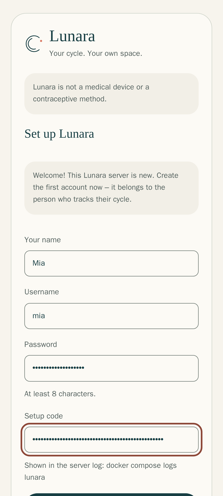
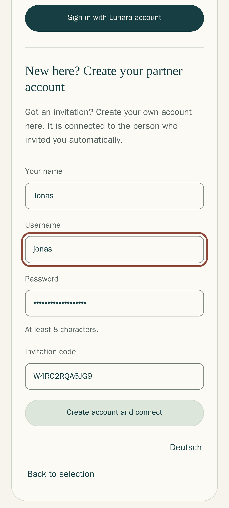
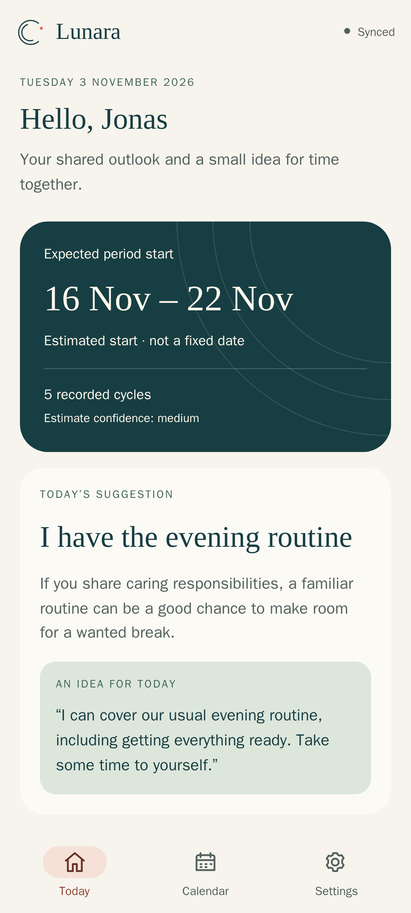
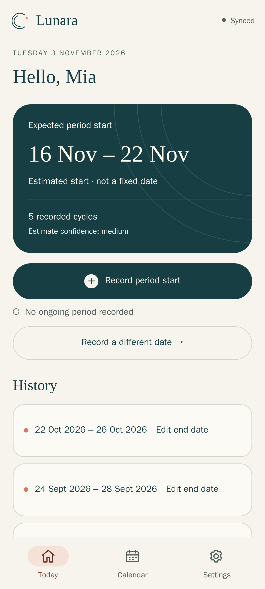
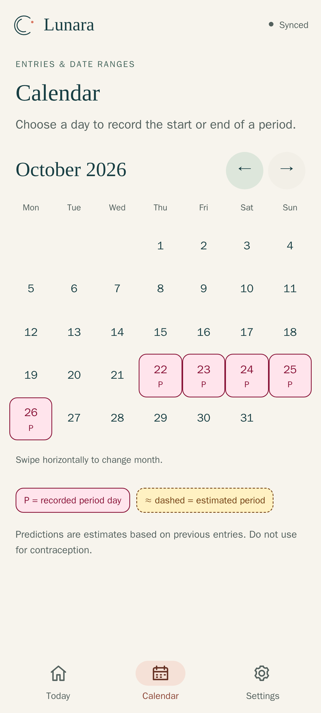

# Installing Lunara on your own server

This guide takes you from an empty server to Lunara running for you and your
partner – in about 10 minutes, without creating any passwords or keys by hand.
It applies to **Lunara 1.6.1**.

All screenshots show the real interface with made-up accounts ("Mia" and
"Jonas").

> Only want to use Lunara on your own Android phone? You do **not need a
> server**: download `lunara-release.apk` from the
> [latest release](https://github.com/eliasbruno124-dev/Lunara/releases/latest),
> install it and choose **Only on this device**.

## Contents

1. [What you need](#1-what-you-need)
2. [Start Lunara](#2-start-lunara)
3. [Create your account](#3-create-your-account)
4. [Invite your partner](#4-invite-your-partner)
5. [Put Lunara on your phones](#5-put-lunara-on-your-phones)
6. [Using the calendar](#6-using-the-calendar)
7. [Existing reverse proxy or Portainer](#7-existing-reverse-proxy-or-portainer)
8. [Updates, backup and restore](#8-updates-backup-and-restore)
9. [How it works](#9-how-it-works)
10. [Troubleshooting](#10-troubleshooting)

## 1. What you need

| What | Why |
| --- | --- |
| A computer that is always on, with [Docker](https://docs.docker.com/engine/install/) | Lunara runs in it. A home server, a Raspberry Pi 4/5 or a small rented server all work |
| About 300 MB of free memory | for Lunara and its database |
| A web address (domain) pointing to that computer, e.g. `lunara.example.com` | the apps only talk to Lunara over HTTPS |
| Ports 80 and 443 reachable from the internet | so Lunara can get its free HTTPS certificate |

<details>
<summary><b>Never done this before? How to get a web address and open the ports</b></summary>

**Rented server (VPS):** it already has a fixed address. At your domain
provider, create an "A record" for e.g. `lunara.your-domain.com` that points to
the server's IP address. Ports 80 and 443 are usually open already.

**At home (Raspberry Pi, home server):**

1. **Free web address:** sign up at a free dynamic-DNS service such as
   [DuckDNS](https://www.duckdns.org) and create a name, e.g.
   `our-lunara.duckdns.org`. Follow their short guide so the name always points
   to your home connection (many routers can do this themselves, e.g. FRITZ!Box:
   *Internet → Permit Access → DynDNS*).
2. **Open the ports in your router** ("port forwarding" / "port sharing"):
   forward **TCP 80** and **TCP 443** to the computer that runs Lunara.
   On a FRITZ!Box: *Internet → Permit Access → Port Sharing → Add Device for
   Sharing*, choose the computer, then add HTTPS (443) and HTTP (80).
3. Use that name as `LUNARA_DOMAIN` in the next step.

Only Lunara's own HTTPS service is reachable this way; the database stays
inside the server.
</details>

## 2. Start Lunara

Run these commands on your server:

```bash
mkdir lunara && cd lunara
curl -fsSLO https://raw.githubusercontent.com/eliasbruno124-dev/Lunara/main/examples/docker-compose.yml
echo "LUNARA_DOMAIN=lunara.example.com" > .env
docker compose up -d
```

Replace `lunara.example.com` with your own address. That's all the
configuration there is. On the first start Lunara:

- creates its database password and encryption keys and keeps them in the
  Docker volume `lunara_secrets`,
- prepares its database in the volume `lunara_database`,
- gets an HTTPS certificate for your address.

After about a minute `https://lunara.example.com/health` shows `{"status":"ok"}`.

## 3. Create your account

The first account belongs to the person who tracks their cycle. To make sure
only you can create it, Lunara prints a one-time **setup code**:

```bash
docker compose logs lunara
```

Open your address in the browser, choose **My own server** and fill in the
form: your name, a username, a password (at least 8 characters) and the setup
code. Tap **Create account** – you are signed in.



The code works only once. Once your account exists, Lunara stops printing it.

## 4. Invite your partner

1. Open **Settings → Using Lunara together → Invite partner** and share the
   invitation link or code with your partner.
2. Your partner opens the same address, chooses **My own server** →
   **I have an invitation**, enters a name, username, password and the code,
   and taps **Create account and connect**. In the Android app the button is
   called **Connect a server or partner** → **I have an invitation**.
3. You decide what your partner sees. At first only the expected date range
   is shared. More details (period dates, fertile window, symptoms …) can be
   switched on one by one in the Android app under **Settings → Privacy
   sharing**; the web app shows the current status but cannot change it yet.

<table>
<tr>
<td width="50%"></td>
<td width="50%"></td>
</tr>
<tr>
<td>Your partner creates their own account with the invitation code.</td>
<td>Your partner's view: the shared outlook and a small idea for the day.</td>
</tr>
</table>

"Not shared" never means "no entries" or "deleted" – it just means you did not
share it.

## 5. Put Lunara on your phones


- **Android:** in Lunara open **Settings → App & connection → Download Android
  app (.apk)**. Open the file and allow the installation. In the app choose
  **Connect a server or partner**, enter your address and sign in.
- **iPhone:** open your address in Safari → **Share → Add to Home Screen**.
  Lunara then opens like a normal app.
- **Computer:** use the browser, or install it via the icon in the address bar.

Lunara starts in English. **Deutsch** can be chosen on the first screen and in
the web settings (Android 13+: also in the system's app-language settings).

<br clear="right">

## 6. Using the calendar

<table>
<tr>
<td width="33%"></td>
<td width="33%"></td>
<td width="33%"></td>
</tr>
<tr>
<td><b>Today</b> shows when your next period will probably start. <i>Record period start</i> records today.</td>
<td><b>Recorded days</b> are pink and marked <b>P</b>. Tap a day to change start or end.</td>
<td><b>Estimated days</b> are yellow with a dashed border and <b>≈</b>.</td>
</tr>
</table>

If you only record the start, Lunara assumes the period ended after five days.
You can correct the end at any time ([details](PERIOD-ENDS.md)).

## 7. Existing reverse proxy or Portainer

Already running a web server on ports 80/443 (Nginx Proxy Manager, Traefik,
Caddy, Pangolin …)? Then use the second file, which leaves out the built-in
HTTPS. Save it under the usual name, so every other command in this guide stays
the same:

```bash
mkdir lunara && cd lunara
curl -fsSL https://raw.githubusercontent.com/eliasbruno124-dev/Lunara/main/examples/docker-compose.proxy.yml -o docker-compose.yml
echo "LUNARA_DOMAIN=lunara.example.com" > .env
docker compose up -d
```

Then connect your proxy – pick the one you use:

<details>
<summary><b>Nginx Proxy Manager</b></summary>

1. Let Nginx Proxy Manager reach Lunara (replace the name with the name of your
   Nginx Proxy Manager container, see `docker ps`):
   ```bash
   docker network connect lunara_web nginx-proxy-manager
   ```
2. In Nginx Proxy Manager: **Hosts → Proxy Hosts → Add Proxy Host**
   - *Domain Names:* `lunara.example.com`
   - *Scheme:* `http`, *Forward Hostname / IP:* `lunara`, *Forward Port:* `3000`
   - tick *Block Common Exploits*
3. Tab **SSL**: *Request a new SSL Certificate*, tick *Force SSL* and
   *HTTP/2 Support*, accept the terms, **Save**.
4. Tab **Advanced** (for instant sync between your phones), paste and save:
   ```nginx
   proxy_buffering off;
   ```
</details>

<details>
<summary><b>Traefik</b></summary>

1. Connect Traefik to Lunara's network (use your Traefik container name):
   ```bash
   docker network connect lunara_web traefik
   ```
2. Add these lines to the `lunara` service in your `docker-compose.yml`
   (adjust the entry point and certificate resolver names to your Traefik
   setup), then run `docker compose up -d` again:
   ```yaml
       labels:
         traefik.enable: "true"
         traefik.docker.network: lunara_web
         traefik.http.routers.lunara.rule: Host(`lunara.example.com`)
         traefik.http.routers.lunara.entrypoints: websecure
         traefik.http.routers.lunara.tls.certresolver: letsencrypt
         traefik.http.services.lunara.loadbalancer.server.port: "3000"
   ```
</details>

<details>
<summary><b>Proxy installed directly on the server (not in Docker)</b></summary>

Forward `https://lunara.example.com` to `http://127.0.0.1:3000`. An nginx
example:

```nginx
location / {
    proxy_pass http://127.0.0.1:3000;
    proxy_set_header Host $host;
    proxy_set_header X-Forwarded-For $proxy_add_x_forwarded_for;
    proxy_set_header X-Forwarded-Proto https;
    proxy_buffering off;
}
```
</details>

Use exactly one proxy in front of Lunara. If port 3000 is already taken on the
server, add `LUNARA_PORT=3100` (any free port) to `.env`.

<details>
<summary><b>Portainer</b> (standalone Docker, not Swarm)</summary>

1. **Stacks → Add stack**, name it `lunara`.
2. *Web editor:* paste the content of
   [`docker-compose.yml`](../examples/docker-compose.yml) (or the proxy version).
3. *Environment variables → Add an environment variable:*
   name `LUNARA_DOMAIN`, value `lunara.example.com`.
4. **Deploy the stack**.
5. **Containers → lunara-lunara-1 → Logs** shows the setup code. Continue with
   [step 3](#3-create-your-account).
</details>

**Sign in with Authentik?** Follow the step-by-step guide in
[AUTHENTIK.md](AUTHENTIK.md) – two lines in `.env` and one button in Lunara.

Want to manage the secrets yourself, use another OIDC provider or build the
image from source? See [DEPLOYMENT.md](../DEPLOYMENT.md).

## 8. Updates, backup and restore

**Update** (read the [release notes](https://github.com/eliasbruno124-dev/Lunara/releases) first):

```bash
docker compose pull
docker compose up -d
```

This always takes the newest version. To stay on a specific one, add e.g.
`LUNARA_VERSION=1.4.0` to `.env`. The database is updated automatically; going
back to an older version is not supported, so take a backup before updating.

**Backup** – the database and the keys belong together. Run in your Lunara
folder; both files are readable only by you:

```bash
umask 077
docker compose exec -T postgres pg_dump -U lunara -Fc lunara > lunara-$(date +%F).dump
docker run --rm -v lunara_secrets:/s:ro alpine tar czf - -C /s . > lunara-secrets-$(date +%F).tgz
```

Keep both files somewhere safe, e.g. on another computer. Without the keys the
backup cannot be read.

**Restore** on a new server: put the two backup files and `docker-compose.yml`
(plus your `.env`) into a folder, then run there:

```bash
docker volume create lunara_secrets
docker run --rm -v lunara_secrets:/s -v "$PWD":/b:ro alpine sh -ec '
  tar xzf /b/lunara-secrets-2026-11-04.tgz -C /s
  for f in postgres_password app_master_key auth_signing_key refresh_token_pepper bootstrap_token; do
    test -s /s/$f || { echo "missing key: $f – wrong backup file?"; exit 1; }
  done
  chown -R 10001:10001 /s'
docker compose up -d --wait postgres
docker compose exec -T postgres pg_restore -U lunara -d lunara \
    --clean --if-exists --single-transaction --exit-on-error < lunara-2026-11-04.dump \
  && docker compose up -d
```

Use your own file names instead of the dates shown. If a key is missing, stop
there – starting without it would create new keys that cannot read the data.

## 9. How it works

```text
  Phone / browser ──HTTPS──► caddy ──► lunara ──► postgres
                                         │
                                  lunara_secrets (keys)
```

- **init** creates the keys once and then stops. If the key volume is ever
  incomplete, Lunara refuses to create new keys, because new keys could not
  read your existing data.
- **lunara** contains the server, the web app and the signed Android app.
- **migrate** updates the database structure on every start; Lunara only starts
  after it succeeded.
- **postgres** is only reachable inside the installation.
- **caddy** provides HTTPS for your address.

Two roles per household: the **tracker** records their cycle, the **partner**
only sees what the tracker shares. Estimates are calculated from past cycles
and always shown as a range ([ALGORITHM.md](../ALGORITHM.md)). Passwords are
stored as Argon2id hashes, sensitive data is encrypted, and there is no
telemetry, advertising or Google service.

> Lunara is **not a medical device** and **not a contraceptive method**.

## 10. Troubleshooting

| Problem | What to do |
| --- | --- |
| `docker compose up` says `Set LUNARA_DOMAIN …` | The `.env` file with `LUNARA_DOMAIN=…` is missing in this folder |
| No setup code in the logs | Your account already exists – just sign in. Otherwise wait a minute and run `docker compose logs lunara` again |
| "The setup code is not correct" | Copy the code again from the logs, without spaces |
| Browser shows a certificate error | The domain does not point to this server yet, or ports 80/443 are blocked |
| `caddy` does not start: port 80/443 in use | Another web server runs there – use `docker-compose.proxy.yml` ([section 7](#7-existing-reverse-proxy-or-portainer)) |
| `init` fails: "secrets volume is incomplete" | Restore `lunara_secrets` from your backup; do not delete it |
| Sign-in: "Too Many Requests" | Too many attempts – wait one minute |
| Android update cannot be installed | Install the new APK over the old app; self-built APKs cannot replace the official one |

Logs: `docker compose logs -f lunara`.
Bugs: [GitHub issues](https://github.com/eliasbruno124-dev/Lunara/issues).
Security problems: please report privately, see [SECURITY.md](../SECURITY.md).
