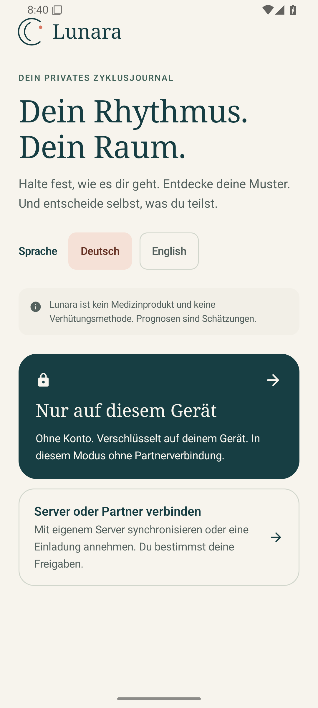
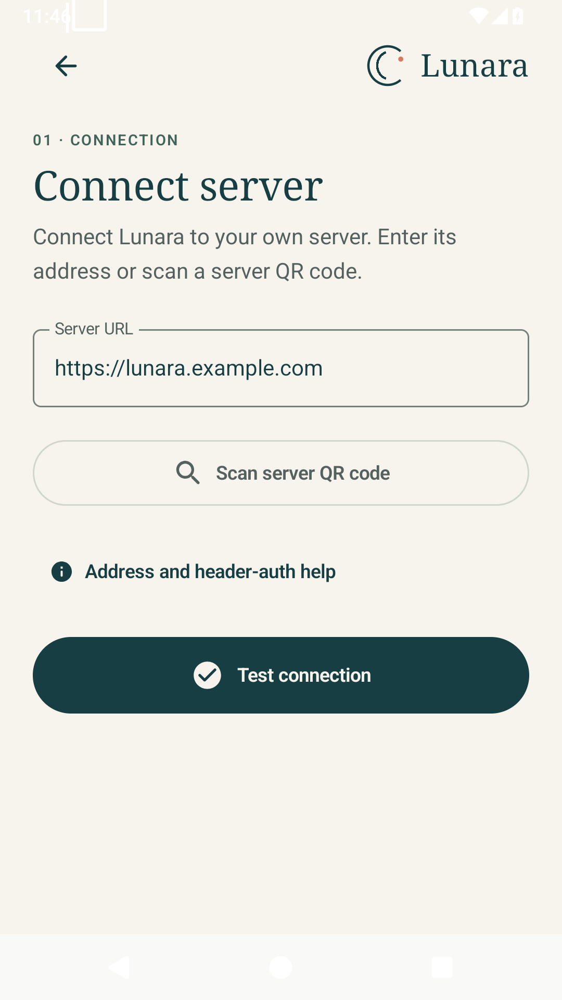
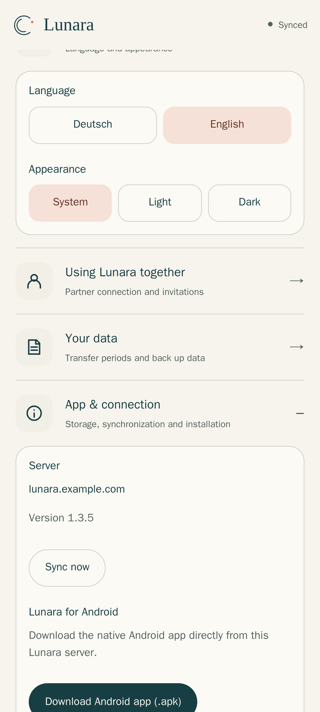
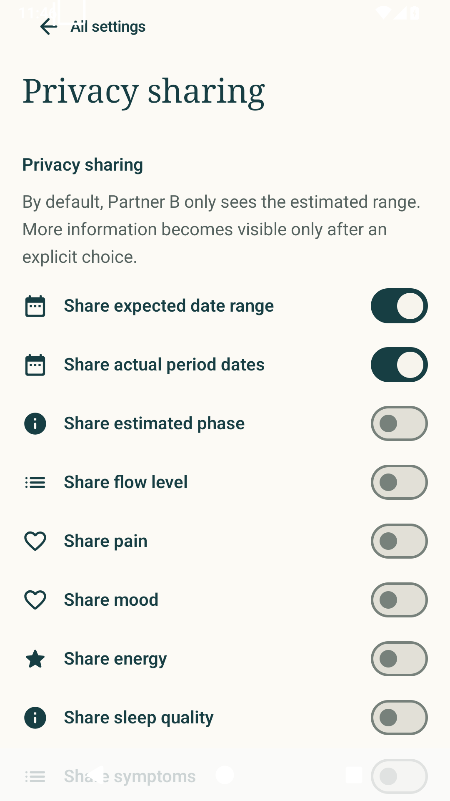
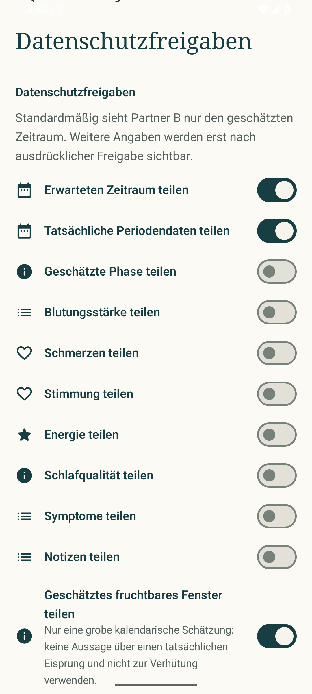
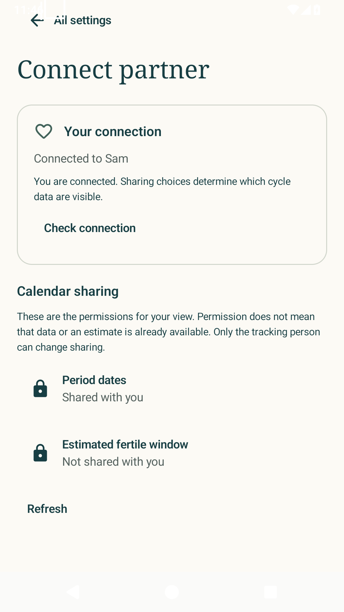
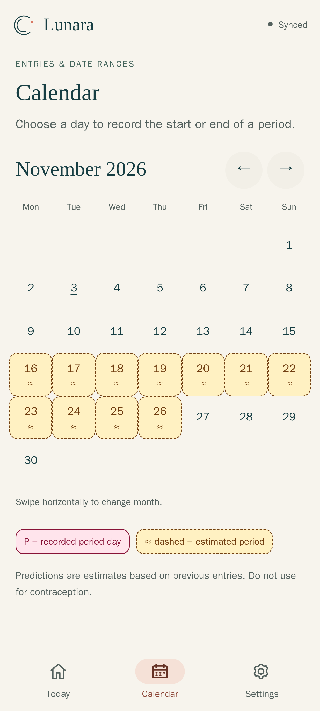

# Setting up Lunara

This guide describes Lunara 1.6.1. The screenshots show the real interface
with synthetic test accounts and sample data; no private accounts, passwords
or health data.

Lunara starts in English on new installations. German can be selected on the
first screen (and on Android 13+ also in the system's per-app language
settings).

## 1. Just for yourself? The APK is enough

For local use on Android you **only need the APK from GitHub and a device with
Android 8 or newer**. You do not need your own server, Docker, Authentik or a
user account. The server guide is not required for this path.

1. Open the [Lunara releases on GitHub](https://github.com/eliasbruno124-dev/Lunara/releases)
   and download the signed `lunara-release.apk` of the release you want.
2. Open the file on Android. If asked, allow installation from the browser or
   file manager you used. Only install files from a source you trust.
3. Start Lunara and choose **Only on this device**.
4. Enter a display name and choose **Start locally**.



The display name does not create a server account. Periods, daily logs, the
calendar and local reminders work on the device. The database is encrypted
with SQLCipher and an Android Keystore key. There is no partner
synchronization in this mode.

Important: uninstalling, clearing the app data or losing the device is not a
way to change devices. Create an
[encrypted backup](#5-backing-up-and-changing-devices) regularly.

## 2. Connecting to your own server

You only need this section for device synchronization or sharing. If no
Lunara server exists yet, the operator sets it up first using
[INSTALL.md](INSTALL.md) or [DEPLOYMENT.md](../DEPLOYMENT.md). The app does not
install a Docker stack or an Authentik server.

### Android

1. On first start choose **Connect a server or partner**.
2. Enter the normal HTTPS address, for example `https://lunara.example.com`.
   Do not put passwords or tokens into the URL.
3. Choose **Test connection**. The matching sign-in or setup path only appears
   after a successful check.



Which option is right afterwards:

| Situation | What to do |
| --- | --- |
| Completely empty server | The operator creates the first tracker account via **Set up Lunara for the first time** using the bootstrap token kept on the server. |
| Existing account | Choose **I already have an account** and sign in with the same identity. |
| New tracker relationship of your own | Only if registration is enabled: choose **Start a new relationship**. |
| Received an invitation as a partner | Choose **I have an invitation** and use the personal code. |
| Authentik is offered | Sign in with your own Authentik account in the system browser; the app receives the return via its verified app link. |

A bootstrap token only belongs in the dedicated app field of your own
instance – never in a chat, screenshot or GitHub. It is not needed for normal
sign-in after setup.

With Authentik, do not accidentally create a new tracker profile if you want to
open an existing profile or join as a partner. The same e-mail address or
display name does not link accounts automatically. On a different API domain
the operator also has to follow the
[publisher app-link requirements](../DEPLOYMENT.md#android-the-api-domain-is-not-the-callback-host)
of the Android build in use.

### Web app

Open the same HTTPS address in the browser. An account that already exists on
the server can sign in there. On an empty server the web app offers
**Set up Lunara** with the setup code from the server log (see
[INSTALL.md](INSTALL.md#3-create-your-account)).

The web app can be installed in supported browsers. On iPhone:
**Share → Add to Home Screen**. Installing the web app and the native Android
APK are two different things.

Under **Settings → App & connection** there is always the native APK download.
It loads `/api/v1/downloads/lunara.apk` from exactly this server. With
Authentik, the existing gateway sign-in is still required.



The web app also has a local solo mode with a passphrase-encrypted vault.
However, it first has to be loaded from a reachable web server. For Android
solo use without your own infrastructure, the APK is the direct path.

## 3. Connecting a partner

The tracking person and the partner use separate accounts. A shared password
is neither needed nor intended.

1. Tracking person: open **Android settings → Connect partner** or
   **Web settings → Using Lunara together** and create an invitation.
2. Only pass the single-use code or invitation link on to the intended person.
   It does not contain an account password.
3. Partner on Android: **Connect a server or partner → I have an invitation**,
   enter or scan the code and create or use your own account. Partner on the
   web (e.g. iPhone): choose **My own server → I have an invitation**, enter a
   name, username, password and the code, and tap **Create account and
   connect**. An existing account can instead enter the code under
   **Settings → Using Lunara together** and confirm the connection.
4. With Authentik, first confirm the intended personal access and redeem the
   invitation with exactly that account.

An existing empty tracker account can become a partner account after explicit
confirmation. An account with existing health data is never silently emptied
or moved. If a connection already exists, do not create additional accounts
"to try things out".

## 4. Choosing what to share

**Being connected is not the same as sharing data.** The tracking person
decides under **Android settings → Privacy sharing** what the partner may see.

For the calendar, these are separate:

- **Share actual period dates**: periods that have already been recorded.
- **Share expected date range**: the estimated next range.
- **Share estimated fertile window**: the optional rough fertility estimate.

<p>
  
  
</p>

The optional fertility estimate additionally has to be enabled on purpose
under **Cycle & estimates**. Sharing alone does not create an estimate. There
must be enough suitable complete cycles; special modes or insufficiently
reliable data can prevent an estimate.

The partner can see the effective status but cannot change it:

- Android: **Settings → Connect partner → Calendar sharing**.
- Web: **Settings → Using Lunara together → Calendar sharing**.



"Not shared" is no indication of deleted data. Conversely, "Shared" does not
guarantee that entries exist or that an estimate can be calculated. With older
servers or a missing response the status can be unknown. States shown offline
are the last saved information, not a current confirmation from the server.

A sharing pause or a private day can restrict the effective visibility. The
partner view does not reveal hidden entries and offers no way to bypass these
protections.

Lunara does not confirm ovulation. The fertile window is an uncertain calendar
estimate and must **not be used for contraception**.

### Calendar colours in the app and on the web

- **Rose, P:** a period day that was actually recorded.
- **Amber, ≈, dashed:** estimated period, including the possible start and
  further days.
- **Teal, F?:** roughly estimated fertile window.

Recorded days take precedence over estimates. Today is underlined; a selection
does not override its category. The legend explains the symbols without
relying on colour. All predictions remain estimates.



### What the estimates mean

Lunara compares the most recent suitable cycle lengths. Few or strongly
varying entries produce wider ranges. The confidence shown is an internal
classification of the data basis, not a measured hit rate. Even regularly
recorded cycles do not guarantee a particular start day.

The fertile window is estimated from the calendar and the configured luteal
phase length. Temperature, LH tests and symptoms are not used to confirm
ovulation. The window is therefore not suitable for contraception. Current
medical recommendations distinguish calendar predictions from observing actual
fertility signs.

If the expected start range has already passed or changes have not been
synchronized yet, the summary does not show a supposedly current prediction.
Existing entries and calendar data are kept.

In server mode, the tracking person's Android view uses the known profile time
zone. The web and partner views do not know this setting yet and check the day
boundary using the device time. When travelling across time zones, the
"current" classification around midnight can therefore differ from the server.
The stored period data is not shifted by this.

## 5. Backing up and changing devices

### Android in solo mode

Open **Settings → Account and security → Portable encrypted backup** and choose
**Create backup**. Save the `.lunara` file to a safe destination of your choice
via the system file dialog. An installed file provider such as Nextcloud,
Google Drive or a USB drive can serve as the destination; Lunara does not need
its own cloud account for this.

Choose your own strong backup passphrase and keep it safe separately. It is not
stored and cannot be reset. On the new device, install the APK, start local
mode and choose **Restore backup** in the same section. The import replaces
existing local data – back that up first if necessary.

Automatic Android cloud backup does not replace this procedure. The device key
cannot be copied to another phone together with normal app files.

### Web solo mode

Export an encrypted backup under **Settings → Your data**. Browser data can be
lost when site storage is cleared or under storage pressure. Without the vault
or backup passphrase the operator cannot restore anything.

### Server operation

Synchronization is not a historical backup. The operator backs up the database
and the master key separately according to the
[backup guide](../DEPLOYMENT.md#8-backups-and-updates) or
[INSTALL.md](INSTALL.md#8-updates-backup-and-restore).

## 6. Transferring periods as CSV/JSON

Under **Android settings → Account and security → Transfer periods** or
**Web settings → Your data → Transfer periods** you can export your own periods
or import them from a file. The feature is meant for the tracking person, also
in local mode. Partners cannot change anyone else's periods with it. Estimates
are not imported as actual periods.

CSV/JSON are **unencrypted health data**, not a password-protected backup. Only
save the files to safe destinations of your choice and do not upload them to
public tickets, chats or Git repositories. For a complete local restore, the
[encrypted backup](#5-backing-up-and-changing-devices) remains the right path.

### Exporting

Explicitly confirm the note about unencrypted data, then choose **Export CSV**
or **Export JSON**. The files contain actual entries. CSV suits spreadsheet
programs; JSON keeps the structured representation. Another cycle app may
require its own import format, though. Lunara does not guarantee direct import
into every third-party app.

The export contains the state currently loaded on the device, including your
own entries that have not been synchronized yet. For the most current server
state, synchronize or refresh first. An offline export is no proof that all
server entries are included.

### Importing

1. Select a CSV or JSON file.
2. Check the preview and possible errors. No periods have been imported yet.
3. Only import the entries after explicit confirmation. A single invalid line
   or overlap blocks the whole import; only identical duplicates are skipped.

In web server mode the connection must be online and the existing
synchronization queue must be processed first. This is checked again before
the preview and the confirmation. The local web vault does not need server
synchronization for this.

Android can also import your own periods offline in server mode. The imported
entries are stored locally and transferred as pending changes through the
normal sync. In Android solo mode they stay exclusively local.

Limits and rules:

- At most **2 MiB** file size and **5,000 periods**.
- Identical periods that already exist are skipped. Overlaps are blocked, not
  silently merged.
- CSV supports comma, semicolon or tab as separator, UTF-8 with or without BOM,
  UTF-16 with BOM and correctly placed quotation marks.
- A start date is required. The end date column is optional. Without an end
  date the period counts as ongoing for at most five days (start day included);
  after that Lunara assumes it ended, also for overlap checks with later
  entries (see [PERIOD-ENDS.md](PERIOD-ENDS.md)). The stored and exported end
  stays empty – the assumption is never saved as a recorded end.
- Invalid data, entries in the future and an end before the start are rejected.
- The standard format `startDate,endDate` and recognized German and English
  column names are supported. Not every third-party export structure is
  automatically compatible.
- `YYYY-MM-DD`, `YYYY/MM/DD` and `DD.MM.YYYY` are unambiguous. Other spellings
  with slashes are only accepted if day and month are unambiguous;
  `01/04/2026` is not guessed.
- JSON accepts the Lunara format shown below, a plain list and unencrypted
  documents with `periods` or `data.periods`. Foreign metadata never changes
  the account, settings or sharing.

An encrypted `.lunara` backup is still opened via the backup restore with its
passphrase, not as a CSV/JSON import.

### Small synthetic examples

This made-up test data only serves to explain the file format.

CSV:

```csv
startDate,endDate
2026-01-04,2026-01-08
2026-02-02,2026-02-06
```

JSON:

```json
{
  "format": "lunara-periods",
  "formatVersion": 1,
  "periods": [
    { "startDate": "2026-01-04", "endDate": "2026-01-08" },
    { "startDate": "2026-02-02", "endDate": "2026-02-06" }
  ]
}
```

For unsupported columns or ambiguous dates, first convert a **copy** of the
file to the unambiguous standard format and check the preview again. Keep the
original as your own backup.

## 7. Updates and frequently asked questions

### Do I have to delete the app before an update?

No. Install the new signed APK over the existing installation. Uninstalling or
clearing the app data can remove local entries and device keys. A self-signed
APK cannot replace the existing signature.

### Why is the partner calendar empty?

First check the connection and refresh status, then look at the two calendar
sharing options in the partner settings. The tracking person decides on
changes. Even with sharing enabled, entries or suitable cycles may still be
missing. Do not "repair" this with new accounts, a reinstall or by clearing
local data.

### Do I stay signed in permanently?

Lunara renews valid credentials automatically but does not promise unlimited
sign-in. Genuinely expired or revoked provider credentials, deleted accounts or
lost device keys can make signing in again necessary.

Use the same account for **Renew sign-in**. Local entries and pending changes
are kept this way; signing out or clearing app data is not needed. With purely
temporary network errors, changes stay in the queue.

### Sign-in gets stuck in the browser

For Authentik, the callback host built into the APK, the redirect allowed in
the provider and the app-signing certificate must match. Your own server
address alone does not determine the Android callback. The operator checks this
using the [deployment guide](../DEPLOYMENT.md). Do not photograph tokens or
password fields for troubleshooting.
