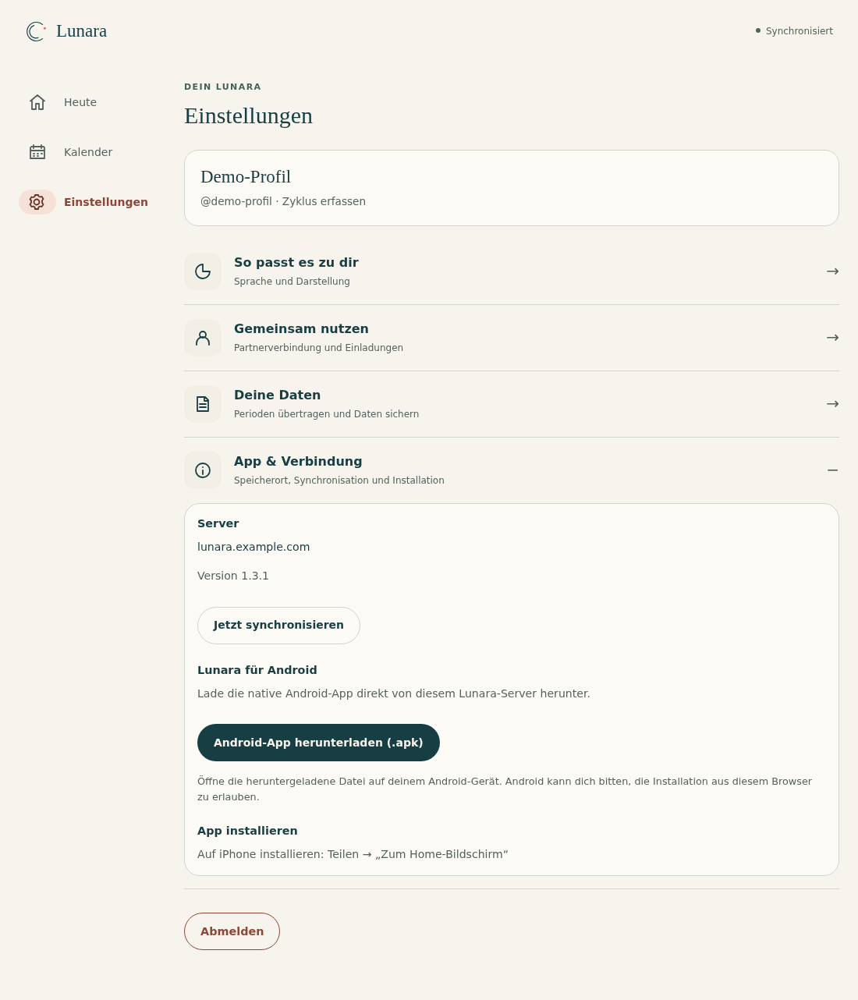
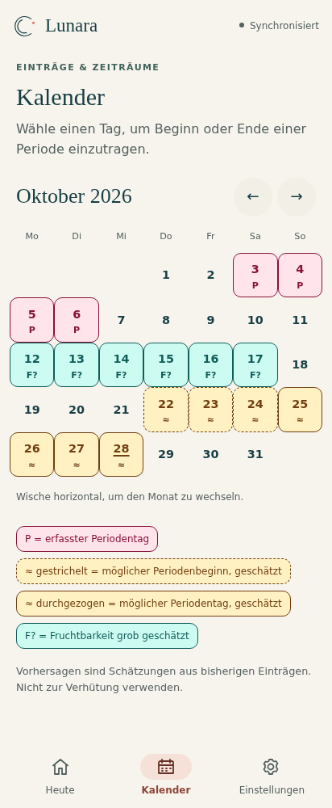
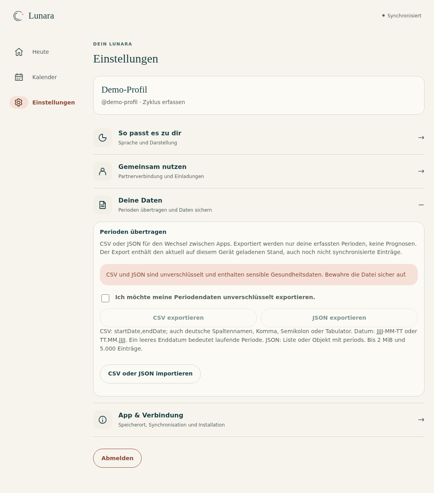
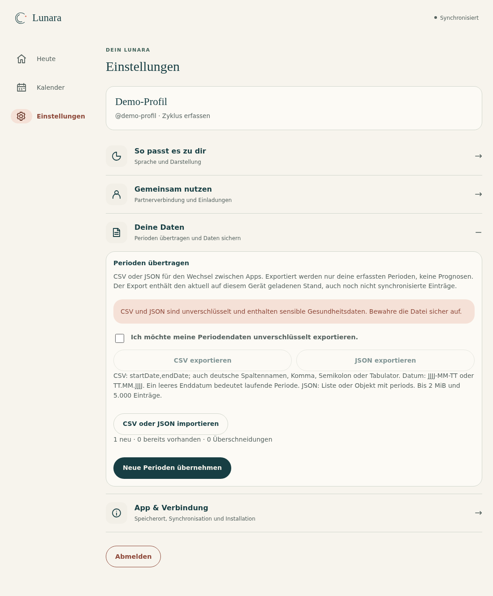

# Lunara einrichten

Diese Anleitung beschreibt Lunara 1.3.2. Die Bilder zeigen die tatsächliche
Oberfläche mit synthetischen Testkonten und Beispieldaten; keine privaten
Konten, Passwörter oder Gesundheitsdaten.

## 1. Nur allein nutzen? Die APK genügt

Für die lokale Android-Nutzung brauchst du **nur die APK aus GitHub und ein
Android-Gerät ab Android 8**. Du benötigst keinen eigenen Server, kein Docker,
kein Authentik und kein Benutzerkonto. Die Server-Anleitung ist für diesen
Weg nicht erforderlich.

1. Öffne die [Lunara-Releases auf GitHub](https://github.com/eliasbruno124-dev/Lunara/releases)
   und lade die signierte `lunara-release.apk` des gewünschten Releases.
2. Öffne die Datei auf Android. Erlaube bei Bedarf die Installation aus dem
   verwendeten Browser oder Dateimanager. Nur Dateien aus einer Quelle
   installieren, der du vertraust.
3. Starte Lunara und wähle **Nur auf diesem Gerät**.
4. Gib einen Anzeigenamen ein und wähle **Lokal starten**.


Der Anzeigename erzeugt kein Serverkonto. Perioden, Tagesprotokolle,
Kalender und lokale Erinnerungen funktionieren auf dem Gerät.
Die Datenbank ist mit SQLCipher und einem Android-Keystore-Schlüssel
verschlüsselt. Es gibt in diesem Modus keine Partnersynchronisation.

Wichtig: Deinstallation, Löschen der App-Daten oder Verlust des Geräts sind
kein Gerätewechselverfahren. Erstelle regelmäßig ein
[verschlüsseltes Backup](#5-sichern-und-das-gerät-wechseln).

## 2. Mit einem eigenen Server verbinden

Diesen Abschnitt brauchst du nur für Geräte-Synchronisation oder die
gemeinsame Nutzung. Falls noch kein Lunara-Server existiert, richtet ihn
der Betreiber zuerst anhand von [DEPLOYMENT.md](../DEPLOYMENT.md) ein.
Die App installiert keinen Docker-Stack und keinen Authentik-Server.

### Android

1. Wähle beim Start **Server oder Partner verbinden**.
2. Trage die normale HTTPS-Adresse ein, zum Beispiel
   `https://lunara.example.com`. Keine Passwörter oder Tokens in die URL
   aufnehmen.
3. Wähle **Verbindung testen**. Erst nach einer erfolgreichen Prüfung
   erscheint der passende Anmelde-/Einrichtungsweg.


Welche Auswahl danach richtig ist:

| Situation | Vorgehen |
| --- | --- |
| Noch vollständig leerer Server | Betreiber erstellt über **Lunara erstmals einrichten** das erste Trackerkonto mit dem lokal verwahrten Bootstrap-Token. |
| Vorhandenes Konto | **Ich habe bereits ein Konto** wählen und mit derselben Identität anmelden. |
| Neue eigene Tracker-Beziehung | Nur bei aktivierter Registrierung **Neue Beziehung starten** wählen. |
| Einladung als Partner erhalten | **Ich habe eine Einladung** wählen und den persönlichen Code verwenden. |
| Authentik wird angeboten | Im Systembrowser mit dem vorgesehenen eigenen Authentik-Konto anmelden; die App erhält die Rückkehr über ihren verifizierten App-Link. |

Ein Bootstrap-Token gehört nur in das dafür vorgesehene App-Feld der eigenen
Instanz – niemals in Chat, Screenshot oder GitHub. Nach der Einrichtung wird
er nicht zum normalen Anmelden gebraucht.

Bei Authentik nicht versehentlich ein neues Trackerprofil anlegen, wenn du
ein bestehendes Profil öffnen oder als Partner beitreten möchtest.
Gleiche E-Mail-Adresse oder gleicher Anzeigename verknüpfen keine Konten
automatisch. Auf einer fremden API-Domain muss der Betreiber außerdem die
[Publisher-App-Link-Vorgaben](../DEPLOYMENT.md#android-api-domain-ist-nicht-der-callback-host)
des verwendeten Android-Builds beachten.

### Web-App

Öffne dieselbe HTTPS-Adresse im Browser. Ein bereits eingerichtetes
Serverkonto kann dort angemeldet werden. Eine leere Instanz wird zuerst
über Android eingerichtet.

Die Web-App lässt sich bei unterstützten Browsern installieren. Auf iPhone:
**Teilen → Zum Home-Bildschirm**. Die Installation als Web-App und die native
Android-APK sind zwei verschiedene Dinge.

Unter **Einstellungen → App & Verbindung** befindet sich immer der native
APK-Download. Er lädt `/api/v1/downloads/lunara.apk` von genau diesem Server.
Bei Authentik bleibt die bestehende Gateway-Anmeldung erforderlich.



Die Web-App hat auch einen lokalen Solomodus mit passphrasenverschlüsseltem
Tresor. Sie muss jedoch zunächst von einem erreichbaren Webserver geladen
werden. Für Android-Solo ohne eigene Infrastruktur ist die APK der direkte
Weg.

## 3. Partner verbinden

Die trackende Person und der Partner verwenden getrennte Konten.
Ein gemeinsames Passwort ist weder nötig noch vorgesehen.

1. Trackende Person: **Android-Einstellungen → Partner verbinden** oder
   **Web-Einstellungen → Gemeinsam nutzen** öffnen und eine Einladung
   erstellen.
2. Den einmal verwendbaren Code beziehungsweise Einladungslink nur an die
   vorgesehene Person weitergeben. Er enthält kein Kontopasswort.
3. Partner: Einladung in der App eingeben oder scannen beziehungsweise den
   Link öffnen und mit dem eigenen Konto ausdrücklich bestätigen.
4. Bei Authentik erst den vorgesehenen persönlichen Zugang bestätigen und
   die Einladung mit genau diesem Konto einlösen.

Ein vorhandenes leeres Trackerkonto kann nach ausdrücklicher Bestätigung
zum Partnerkonto werden. Ein Konto mit bestehenden Gesundheitsdaten wird
nicht stillschweigend geleert oder verschoben. Ist bereits eine Verbindung
vorhanden, keine weiteren Konten „zum Ausprobieren“ anlegen.

## 4. Freigaben bewusst wählen

**Verbunden zu sein ist nicht dasselbe wie Daten zu teilen.** Die trackende
Person entscheidet unter **Android-Einstellungen → Datenschutzfreigaben**,
was der Partner sehen darf.

Für den Kalender sind insbesondere getrennt:

- **Tatsächliche Periodendaten teilen**: bereits erfasste Perioden.
- **Erwarteten Zeitraum teilen**: geschätzter nächster Zeitraum.
- **Geschätztes fruchtbares Fenster teilen**: die optionale grobe
  Fruchtbarkeitsschätzung.

<p>
  
  
</p>

Die optionale Fruchtbarkeitsschätzung muss zusätzlich unter
**Zyklus & Schätzungen** bewusst aktiviert sein. Eine Freigabe allein erzeugt
noch keine Schätzung. Es müssen genügend geeignete vollständige Zyklen
vorliegen; Sondermodi oder unzureichend verlässliche Daten können eine
Schätzung verhindern.

Der Partner kann den effektiven Status ansehen, aber nicht umschalten:

- Android: **Einstellungen → Partner verbinden → Kalenderfreigaben**.
- Web: **Einstellungen → Gemeinsam nutzen → Kalenderfreigaben**.


„Nicht freigegeben“ ist kein Hinweis auf gelöschte Daten. „Freigegeben“
garantiert umgekehrt noch keine vorhandenen Einträge oder berechenbare
Schätzung. Bei älteren Servern oder fehlender Antwort kann der Status
unbekannt sein. Offline angezeigte Zustände sind zuletzt gespeicherte
Informationen, keine aktuelle Bestätigung des Servers.

Eine Freigabepause oder ein privater Tag kann die effektive Sichtbarkeit
einschränken. Die Partneransicht verrät daraus keine verborgenen Einträge
und bietet keine Möglichkeit, diese Schutzmechanismen zu umgehen.

Lunara bestätigt keinen Eisprung. Das fruchtbare Fenster ist eine unsichere
Kalenderschätzung und darf **nicht zur Verhütung** verwendet werden.

### Kalenderfarben in App und Web

- **Rosé, P:** tatsächlich erfasster Periodentag.
- **Amber, ≈, gestrichelt:** möglicher Periodenbeginn.
- **Amber, ≈, durchgezogen:** weiterer möglicher Periodentag.
- **Türkis, F?:** grob geschätztes fruchtbares Fenster.

Erfasste Tage haben Vorrang vor Schätzungen. Der heutige Tag ist unterstrichen;
eine Auswahl überschreibt seine Kategorie nicht. Die Legende erklärt die
Symbole auch ohne Farberkennung. Alle Prognosen bleiben Schätzungen.



## 5. Sichern und das Gerät wechseln

### Android im Solomodus

**Einstellungen → Konto und Sicherheit → Portables verschlüsseltes Backup**
öffnen und **Backup erstellen** wählen. Die `.lunara`-Datei über den
Systemdateidialog an einem eigenen sicheren Ziel speichern. Ein installierter
Dateianbieter wie Nextcloud, Google Drive oder ein USB-Speicher kann dabei
als Ziel dienen; Lunara benötigt dafür kein eigenes Cloudkonto.

Eine eigene starke Backup-Passphrase wählen und getrennt sicher aufbewahren.
Sie wird nicht gespeichert und kann nicht zurückgesetzt werden.
Auf dem neuen Gerät die APK installieren, den lokalen Modus starten und
im selben Bereich **Backup wiederherstellen** wählen. Der Import ersetzt
vorhandene lokale Daten – vorher gegebenenfalls ebenfalls sichern.

Automatisches Android-Cloudbackup ersetzt dieses Verfahren nicht. Der
Geräteschlüssel lässt sich nicht zusammen mit normalen App-Dateien auf ein
anderes Handy kopieren.

### Web-Solomodus

Unter **Einstellungen → Deine Daten** ein verschlüsseltes Backup exportieren.
Browserdaten können durch Löschen des Website-Speichers oder bei
Speicherdruck verloren gehen. Ohne Tresor-/Backup-Passphrase gibt es keine
Wiederherstellung durch den Betreiber.

### Serverbetrieb

Synchronisation ist kein historisches Backup. Der Betreiber sichert die
Datenbank und den Master-Key getrennt nach der
[Backup-Anleitung](../DEPLOYMENT.md#8-backup-und-updates).

## 6. Perioden als CSV/JSON übertragen

Unter **Android-Einstellungen → Konto und Sicherheit → Perioden übertragen** beziehungsweise
**Web-Einstellungen → Deine Daten → Perioden übertragen** lassen sich
eigene Perioden exportieren oder aus einer Datei importieren. Die Funktion
ist für die trackende Person vorgesehen, auch im lokalen Modus. Partner
können damit keine fremden Perioden verändern. Schätzungen werden nicht als
tatsächliche Perioden übernommen.

CSV/JSON sind **unverschlüsselte Gesundheitsdaten**, keine passwortgeschützte
Sicherung. Dateien nur an selbst gewählte sichere Ziele speichern und nicht
in öffentliche Tickets, Chats oder Git-Repositories hochladen.
Für eine vollständige lokale Wiederherstellung bleibt das
[verschlüsselte Backup](#5-sichern-und-das-gerät-wechseln) der richtige Weg.

### Exportieren

Den Hinweis auf unverschlüsselte Daten bewusst bestätigen und anschließend
in Android **Als CSV exportieren** oder **Als JSON exportieren** wählen;
im Web heißen die Schaltflächen **CSV exportieren** und **JSON exportieren**. Die Dateien
enthalten tatsächliche Einträge. CSV ist für Tabellenprogramme geeignet;
JSON erhält die strukturierte Darstellung. Eine andere Zyklus-App kann
jedoch ein eigenes Importformat verlangen. Lunara garantiert nicht den
direkten Import in jede Fremd-App.

Exportiert wird der aktuell auf dem Gerät geladene Stand, einschließlich
noch nicht synchronisierter eigener Einträge. Für einen möglichst aktuellen
Serverstand zuerst synchronisieren beziehungsweise aktualisieren. Ein
Offline-Export ist kein Nachweis, dass alle Servereinträge enthalten sind.



### Importieren

1. Eine CSV- oder JSON-Datei auswählen.
2. Die Vorschau und mögliche Fehler prüfen. Noch wurden keine Perioden
   übernommen.
3. Erst nach ausdrücklicher Bestätigung die Einträge importieren. Eine
   ungültige Zeile oder Überschneidung blockiert den gesamten Import;
   lediglich identische Duplikate werden übersprungen.



Im Web-Servermodus muss die Verbindung online sein und die vorhandene
Synchronisationswarteschlange zuerst abgearbeitet werden. Das wird vor
Vorschau und Bestätigung erneut geprüft. Der lokale Web-Tresor benötigt
dafür keine Serversynchronisation.

Android kann eigene Perioden auch im Servermodus offline importieren.
Die übernommenen Einträge werden lokal gespeichert und als wartende
Änderungen über den normalen Sync übertragen. Im Android-Solomodus bleiben
sie ausschließlich lokal.

Grenzen und Regeln:

- Maximal **2 MiB** Dateigröße und **5.000 Perioden**.
- Bereits vorhandene identische Perioden werden übersprungen.
  Überschneidungen werden blockiert, nicht still zusammengeführt.
- CSV unterstützt Komma, Semikolon oder Tabulator als Trennzeichen,
  UTF-8 mit oder ohne BOM, UTF-16 mit BOM und korrekt gesetzte
  Anführungszeichen.
- Ein Startdatum ist erforderlich. Die Enddatumsspalte ist optional;
  ein fehlendes Enddatum bezeichnet eine **noch laufende, offene Periode**,
  kein unbekanntes historisches Ende. Sie bleibt offen, bis du sie beendest,
  und kann deshalb mit späteren Einträgen kollidieren. Ein Ende wird nicht
  erraten.
- Ungültige Daten, Einträge in der Zukunft und ein Ende vor dem Beginn
  werden abgelehnt.
- Unterstützt werden das Standardformat `startDate,endDate` sowie erkannte
  deutsche und englische Spaltenbezeichnungen. Nicht jede fremde
  Exportstruktur ist automatisch kompatibel.
- Eindeutig sind `YYYY-MM-DD`, `YYYY/MM/DD` und `DD.MM.YYYY`.
  Weitere Schreibweisen mit Schrägstrichen werden nur übernommen, wenn
  Tag und Monat eindeutig sind; `01/04/2026` wird nicht geraten.
- JSON akzeptiert das unten gezeigte Lunara-Format, eine direkte Liste
  sowie unverschlüsselte Dokumente mit `periods` oder `data.periods`.
  Fremde Metadaten verändern weder Konto noch Einstellungen oder Freigaben.

Eine verschlüsselte `.lunara`-Sicherung wird weiterhin über die eigene
Backup-Wiederherstellung mit Passphrase geöffnet, nicht als CSV/JSON-Import.

### Kleine synthetische Beispiele

Diese frei erfundenen Testdaten dienen nur zum Verstehen des Dateiformats.

CSV:

```csv
startDate,endDate
2026-01-04,2026-01-08
2026-02-02,2026-02-06
```

JSON:

```json
{
  "format": "lunara-periods",
  "formatVersion": 1,
  "periods": [
    { "startDate": "2026-01-04", "endDate": "2026-01-08" },
    { "startDate": "2026-02-02", "endDate": "2026-02-06" }
  ]
}
```

Bei nicht unterstützten Spalten oder mehrdeutigen Datumswerten die Datei
zuerst in einer **Kopie** auf das eindeutige Standardformat bringen und die
Vorschau erneut kontrollieren. Das Original als eigene Sicherung behalten.

## 7. Updates und häufige Fragen

### Muss ich die App vor einem Update löschen?

Nein. Die neue signierte APK über die vorhandene Installation installieren.
Deinstallation oder das Löschen der App-Daten kann lokale Einträge und
Geräteschlüssel entfernen. Eine selbst signierte APK kann die bestehende
Signatur nicht ersetzen.

### Warum ist der Partnerkalender leer?

Zuerst Verbindung und Aktualisierungsstatus prüfen, dann die beiden
Kalenderfreigaben in den Partner-Einstellungen ansehen. Die trackende Person
entscheidet über Änderungen. Bei erteilter Freigabe können noch Einträge
oder geeignete Zyklen fehlen. Nicht durch neue Konten, Neuinstallation oder
Löschen lokaler Daten „reparieren“.

### Bleibe ich dauerhaft angemeldet?

Lunara erneuert gültige Zugangsdaten automatisch, verspricht aber keinen
unbegrenzten Login. Tatsächlich abgelaufene oder widerrufene
Provider-Zugangsdaten, gelöschte Konten oder verlorene Geräteschlüssel
können eine erneute Anmeldung nötig machen.

Bei **Anmeldung erneuern** dasselbe Konto verwenden. Lokale Einträge und
wartende Änderungen bleiben bei diesem Weg erhalten; Abmelden oder
App-Daten löschen ist dafür nicht nötig. Bei rein vorübergehenden
Netzfehlern bleiben Änderungen in der Warteschlange.

### Die Anmeldung bleibt im Browser hängen

Für Authentik müssen der im APK festgelegte Callback-Host, der im Provider
erlaubte Redirect und das App-Signing-Zertifikat zusammenpassen. Die eigene
Serveradresse allein bestimmt den Android-Callback nicht.
Der Betreiber prüft das anhand der [Deployment-Anleitung](../DEPLOYMENT.md).
Keine Tokens oder Passwortfelder zur Fehlersuche fotografieren.
